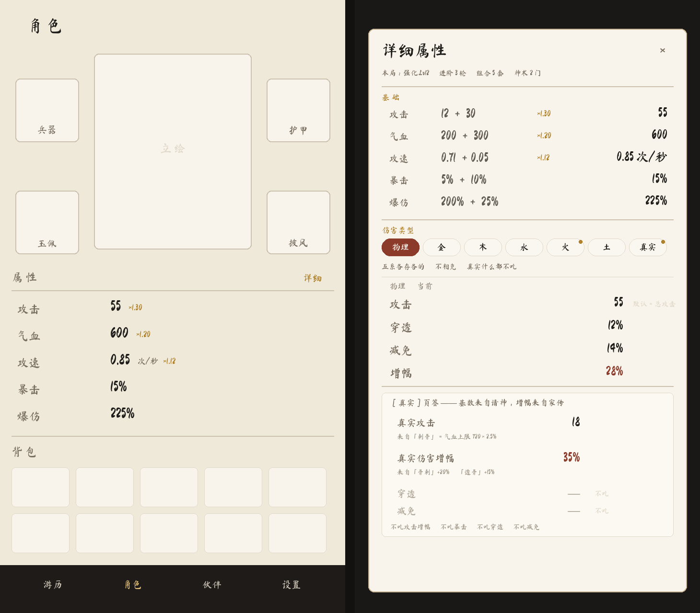

# 人物属性 · 设计稿（定稿 v6）

> 草图（三联：角色页 / 详细页 / 属性弹窗）：



> 生成日期：2026-11-11 · 依据代码：`kushou/kushou_battle.gd` · `kushou/battle_ui.gd` · `menu/character_home.gd`

---

## 〇、五句话记住全部

1. **全场只有主角一个人**，这套属性全是他的；请神只是让他多一门本事，不换人上场
2. **白是骨架，绿是堆出来的肉，金是乘上去的杠杆**
3. **基础属性 ＝（基础 ＋ 临时）× 增幅**；攻击、气血、攻速三条同构
4. **伤害分七种**：物理 · 金 · 木 · 水 · 火 · 土 · 真实；六系各记各的账，**不相克**
5. **真实伤害什么都不吃**，只吃「真实伤害增幅」

---

## 一、属性总表

### 1.1 基础 5 条（角色页显示前 3 条）

| # | 属性 | 基础值 | 临时（绿） | 增幅（金） | 上限 |
|---|---|---|---|---|---|
| 1 | **攻击** | 12 | 装备 / 强化 / 卡组 / 进阶 | 攻击增幅 % | — |
| 2 | **气血** | 200 | 同上 | 气血增幅 % | — |
| 3 | **内力** | 100 | 同上 | 内力增幅 % | — |
| 4 | **攻速** | **1.8 秒/刀** | 同上 | 攻速加成 % | 最快 0.72 秒/刀 |
| 5 | **暴击** | 5% | 同上（百分点） | — | 75% |
| 6 | **爆伤** | 200% | 同上（百分点） | — | 400% |

- **前四条有「增幅」层**（它们是可乘的实数值）；暴击/爆伤是百分点，加法即得
- 角色页显示 **攻击 / 气血 / 内力 / 攻速** 四条一行，其余全在详细页

### 1.2 伤害类型 7 页签

| 页签 | 固定段 | 百分比段 | 上限 |
|---|---|---|---|
| **物理** | ＋该系临时攻击 | 攻击增幅 | — |
| **金 / 木 / 水 / 火 / 土** | ＋该系临时攻击 | 攻击增幅 | — |
| | **穿透**：－N 个百分点 | 再削剩余减免 M% | 60% |
| | **减免**：＋N 个百分点 | 再按 M% 减一次 | 60% |
| | **增幅**：＋N 个百分点 | 再按 M% 放大 | 200% |
| **真实** | 真实攻击（独立，见第四节） | **真实伤害增幅** | 200% |

> **每系各存一个「临时攻击」字段**（默认 0）：`该系攻击 ＝ 最终攻击 ＋ 该系临时`。这条是内部规则，**不上界面**。
>
> **五系不相克**：不做「金克木」那类关系，只做五本独立的账。
>
> **每页只列三行**：穿透 / 减免 / 增幅。真实页只有两行（穿透、减免灰掉写 —）。

---

## 二、公式

### 2.1 基础 5 条

```
最终攻击 = (基础攻击 + 临时攻击) × (1 + 攻击增幅%)
最终气血 = (基础气血 + 临时气血) × (1 + 气血增幅%)
最终攻速 = 1.8 ÷ (1 + 攻速加成%)          ← 秒/刀，显示时换算成「次/秒」
最终暴击 = 基础暴击 + 临时暴击              → 封顶 75%
最终爆伤 = 基础爆伤 + 临时爆伤              → 封顶 400%
```

> 界面显示：攻速写 **次/秒**（`1 ÷ 秒数`），1.8 秒/刀 ＝ **0.56 次/秒**。

### 2.2 每一系的攻击值

```
物理攻击值 = 最终攻击 + 物理临时        （六系各一个临时字段，默认 0）
金系攻击值 = 最终攻击 + 金临时
真实攻击值 = 真实攻击                    ← 由请神技能换算，不吃总攻击
```

### 2.3 打出去

```
物理伤害 = 物理攻击值 × (1 + 物理增幅%) × (暴击 ? 爆伤 : 1)
金系伤害 = 金系攻击值 × (1 + 金系增幅%)
木/水/火/土 同理
真实伤害 = 真实攻击 × (1 + 真实伤害增幅%)
```

- **暴击只吃物理**；六种元素与真实都不暴击
- 增幅的「固定 ＋ 百分比」先合成一个数：`最终增幅 = 固定增幅 × (1 + 百分比增幅)`，再乘进去

### 2.4 挨打：减免两段（已定稿）

```
受伤 = 伤害 × (1 − 固定减免) × (1 − 百分比减免)
```

- **固定减免**：百分点（30 ＝ 减 30%）
- **百分比减免**：**稀有属性** —— 它和穿透是乘算，后期极强；常规只给固定减免
- 真实伤害：**全额**，减免一层都不吃

### 2.5 穿透两段（已定稿，作用在对手的减免上）

```
剩余减免 = max(0, 对手固定减免 − 我固定穿透) × (1 − 我百分比穿透)
受伤     = 伤害 × (1 − 剩余减免) × (1 − 对手百分比减免)
```

举例（我：固定穿透 18、百分比穿透 50%；对手：固定减免 30%）：

```
第 1 段  30 − 18        = 12      ← 固定穿透，直接扣点数
第 2 段  12 × (1 − 50%) =  6      ← 百分比穿透，把剩下的削一半
结果     对手只剩 6% 减免，我打他按 94% 算
```

> **穿透没有「合计值」** —— 取决于对手，所以面板并列显示两段：`18 / 50%`。

### 2.6 上限

| 属性 | 上限 |
|---|---|
| 暴击 | 75% |
| 爆伤 | 400% |
| 攻速 | 最快 0.72 秒/刀（攻速加成 +150%） |
| 固定 / 百分比 穿透 | 各自封顶 60% |
| 固定 / 百分比 减免 | 各自封顶 60% |
| 物理 / 元素 增幅 | 200% |

---

## 三、界面

### 3.1 角色页（只放 3 条，排版沿用现状）

**一行四条**（2026-11-11 用户定）：「攻击 · 气血 · 内力 · 攻速」，不再分两行。

| 项 | 值 |
|---|---|
| 起点 | `x = 24`、`y = 690` |
| 列距 | `168`（`24 / 192 / 360 / 528`） |
| 标签 | 20px 灰，数值 24px 墨，数值在标签右边 `+76` |
| 攻速 | 显示 `0.56/秒`（＝ 1 ÷ 1.8） |

原来的「防御 / 速度 / 暴击 / 闪避」两行**全部下线**。

- 属性标题右侧一行 14px 灰字「点属性看详细」——是提示，不是按钮
- **点任意一条**（图标 / 名字 / 数字都行）→ 直接打开详细属性
- 没有［详细］按钮；属性格按下时描边加深即可

### 3.2 详细页（只写结果）

```
┌ 详细属性 ─────────────────────── × ┐
│                                    │
│  基 础                             │
│   ⚔ 攻击                    55     │
│   ♥ 气血                   600     │
│   ➤ 攻速           0.85 次/秒      │
│   ✦ 暴击                   15%     │
│   ✸ 爆伤                  225%     │
│                                    │
│  ───────────────────────────────   │
│                                    │
│  伤害类型                          │
│   (物理)(金)(木)(水)(火)(土)(真实)  │
│                                    │
│   ➹ 穿透       18 / 50%            │
│   ⛨ 减免       30 / 50%            │
│   ⇑ 增幅       25 / 20%            │
│                                    │
│   点任意一行看说明                  │
└────────────────────────────────────┘
```

**排版参数**（按 720 宽）：

| 元素 | 值 |
|---|---|
| 面板 | `(28, 56) – (692, 1224)` |
| 标题 | 42px，左边距 64 |
| 分组标签 | 18px 金色 |
| 行高 | **100px** |
| 名称 | 30px 灰 |
| 结果数值 | **46px 墨黑**，右对齐 `x = 470` |
| 百分比段 | 40px 金色，同样右对齐 `x = 470` |
| 页签 | 82×50，圆角 25，间距 3 |

**规则**：

- 基础 5 条**只写结果**，一个字都不解释
- 穿透 / 减免 / 增幅 写两段：`固定 / 百分比`，**固定值不带 %**、百分比段才带；中间的 `/` 用浅灰，不抢眼
- 真实页签：穿透、减免灰掉写 `—`
- 超上限变红并标 `(上限 60%)`，不偷偷封顶

### 3.3 属性弹窗（点开才有算式）

```
┌──────────────────────────────────┐
│  ⚔  攻 击                      × │
│ ──────────────────────────────── │
│ 基础攻击                    12   │
│ 临时攻击                   +30   │
│ ──────────────────────────────── │
│ （基础 ＋ 临时）× 增幅           │
│   12 ＋ 30                  42   │
│   42 × 130%                 55   │
│ ──────────────────────────────── │
│ 白 12 ＋ 绿 30                   │
│ × 130% ＝ 55                     │
│ 点空白处关闭                     │
└──────────────────────────────────┘
```

**字号要够大**（卡片宽 608，高度按内容收 ≈ 840）：标题 **56** · 条目名 **38** · 数值 **50** · 公式行 **34** · 算式行 **40** · 结果 **46**。

- 角色页、详细页、战斗中属性窗**共用同一个组件**
- 点窗外空白处 / 右上 × 关闭；**不暂停战斗**

### 3.4 颜色语言

| 颜色 | 含义 | 出现在 |
|---|---|---|
| **墨黑** | 结果值 | 角色页 · 详细页 · 弹窗 |
| **绿** | 临时加成 | **只在弹窗**（详细页不写拆解） |
| **金** | 百分比增幅 / 百分比穿透那一段 | 弹窗 · 详细页的斜杠右边 |
| **红** | 超上限 | 详细页 |

> 增幅写成 `×130%` 而不是 `×1.30`：1.0 和 1.3 在屏幕上几乎看不出差别，100% 和 130% 一眼就知道「这是三成」。100% ＝ 没有增幅。

### 3.5 图标

| 属性 | 图标 | 长相 |
|---|---|---|
| 攻击 | 剑 | 斜置一刀带护手 |
| 气血 | 心 | 实心小桃心 |
| 攻速 | 风 | 三道渐快的速度线 |
| 暴击 | 星 | 四角星 |
| 爆伤 | 爆 | 放射状短芒 |
| 穿透 | 箭 | 箭穿一条横线 |
| 减免 | 盾 | 盾形轮廓 |
| 增幅 | 升 | 向上的箭头 |
| 真实 | 菱 | 空心菱形 |

元素页签**直接用字**（金 / 木 / 水 / 火 / 土），不另画图标。

---

## 四、真实伤害（请神专属）

**真实攻击不是装备词条，是每门真伤神术自带的换算公式**：

| 神术 | 基数公式 | 备注 |
|---|---|---|
| 陈石 · 刺骨 | 气血上限 × 2.5% | 挨打时反伤 |
| 白起后人 · 杀神 | 目标已损失气血 × 系数 | 越残越致命 |
| 鬼见愁 · 斩首 | 治疗量的一部分 | 回得越多打得越疼 |
| 药王 / 玄阴 / 血煞 / 盾卫 | 治疗量 / 内力上限 / 生命上限 / 盾值 → 真伤 | 换算系 |
| 法度 · 碎裂 | 累计脱 10 层 → 范围真伤 | 条件触发 |

**真实伤害增幅**来自家传卡（骨刺 +20% · 透骨 +15% · 骨鲠 +10%…）。

**四条铁律**：

- ❌ 不吃攻击增幅　❌ 不吃暴击 / 爆伤　❌ 不吃穿透　❌ 不吃减免
- 只吃「真实伤害增幅」这一条

> 基数公式由每门神术自己定（可以按攻击、气血、内力、盾值、已损血…）；面板只是把「你当前这门」算出来的数摆出来，不做成一条全局属性。
>
> 「刽子手」按 `攻击 × 1.2` 算也是设计 —— 那是招式自带的换算。

---

## 五、成长来源分工

| 来源 | 填哪一格 | 给什么 |
|---|---|---|
| **装备四槽** | 临时 | 攻击 / 气血 / 固定减免 |
| **强化（文钱）** | 临时 | 每级：攻击 +1 · 气血 +10 · 双减免 +0.4% |
| **进阶（每 10 级）** | 增幅 | 攻击/气血/攻速增幅，或直接给暴击/爆伤/穿透/减免 |
| **卡组** | 两格都填 | 按 10 个卡系各管一条线 |
| **羁绊（宝物）** | 增幅 | 放大已成型组合 |
| **请神（神术）** | 不填 | 只给技能与特性 |

> 强化只填「临时」，进阶只填「增幅」—— 有钱变数字，每 10 级变乘区。

---

## 六、数值锚点

**开局**：攻击 12 · 气血 200 · **攻速 1.8 秒/刀（0.56 次/秒）** · 暴击 5% · 爆伤 200% · 其余全 0

**强化**：价钱 `30 + 12×当前级`（10 级 840 文），每 10 级一次进阶三选一。

**进阶池（12 条，全部填增幅栏）**：

破军 攻击增幅 +15% · 铁骨 气血增幅 +20% · 疾风 攻速加成 +12% · 会心 暴击 +8% · 锐意 爆伤 +25% · 玄甲 固定减免 +8% · 金刚 百分比减免 +6%（稀有） · 贯石 固定穿透 +8% · 破法 百分比穿透 +8% · 剑意 增幅 +10% · 术成 元素增幅 +10% · 血战 击杀回血 +3%

**曲线检查**：

| 时点 | 攻击 | 气血 | 暴击 | 固定减免 | 说明 |
|---|---|---|---|---|---|
| 开局 | 12 | 200 | 5% | 0% | 一刀 12，怪血 34 → 3 刀一只 |
| 第 10 波 | ≈ 40 | ≈ 500 | 15% | 8% | 怪血 ≈ 90、怪攻 ≈ 9.7 |
| 第 20 波 | ≈ 120 | ≈ 1,200 | 25% | 14% | 靠卡组与进阶拉开 |

---

## 七、与现有代码的对接

好消息：五系元素 + 真实在 `kushou_battle.gd` 里本来就有（`DMG_METAL/WOOD/FIRE/WATER/EARTH/TRUE`、`dmg_elem{}`、`res_elem{}`、`dmg_true`）。

| 旧字段 | 新位置 | 处理 |
|---|---|---|
| `atk` | 攻击（基础 ＋ 临时） | 拆两段 |
| `hp` / `hp_max` | 气血 | 拆两段 |
| `aspd`（显示 1.00） | 攻速（默认 1.8 秒/刀） | 界面换算成次/秒 |
| `crit` / `crit_dmg` | 暴击 / 爆伤 | 单层 |
| `dmg_all` | 物理增幅 / 元素增幅 | 拆到七页 |
| `dmg_elem{金木水火土}` | 该系增幅 | 直接对上 |
| `res_elem{金木水火土}` | 该系固定减免 | 直接对上 |
| `dmg_true` | 真实伤害增幅 | 直接对上 |
| `def`（数值减伤） | 固定减免 | **删**，改成百分点 |
| `cut`（只物理 %） | 固定减免 | 合并 |
| `cut_all`（全减免） | 七系固定减免 | 拆 |
| 无 | 各系临时攻击 / 各系穿透 / 百分比减免 | 新增 |
| `dodge` 闪避 | —— | **删除** |
| `lucky` / 吸血 / 破甲 | 特性 | 不上面板 |

---

## 八、闪避下线清单

| 位置 | 改法 |
|---|---|
| `kushou_battle.gd:255` | 删 dodge 字段 |
| `kushou_battle.gd:1111` | 删免伤判定，怪打人**必中** |
| `kushou_battle.gd:3238` | agi 映射改成攻速加成 |
| `battle_ui.gd:1067` | 面板读 dodge → 换新详细页 |
| `battle_ui.gd:1374` | 进阶「身法」→「游身」固定穿透 +6% |
| `menu/character_home.gd:161` | 写死的「闪避 5%」→ 3 条新属性 |

> ⚠ 生存影响：命中 95% → 100%，同时删掉「防御」。上线这版要同步把 `BASE_FOE_ATK` 从 4.5 调到 **≈ 3.8**，或把强化减免给足。

---

## 九、落地顺序

| 步骤 | 内容 | 影响面 |
|---|---|---|
| 1 | hero 加「基础 / 临时」两段、加六系临时攻击、删 dodge | `kushou_battle.gd` |
| 2 | 统一取值函数 final_of / type_atk | `kushou_battle.gd` |
| 3 | 换 hero_out_dmg / hero_in_dmg（穿透两段、减免两段） | `kushou_battle.gd` |
| 4 | 迁移卡池 own_key、进阶 12 条、羁绊口径 | `card_data.gd` `battle_ui.gd` |
| 5 | 角色页 3 条 | `character_home.gd` |
| 6 | 详细页 + 点击弹窗 | 新组件 |
| 7 | 删旧字段 ＋ 调 BASE_FOE_ATK | `kushou_battle.gd` |

每一步都能单独提交、单独验证，不一口气全改。

---

## 十、已定 / 待定

### 已定

| 项 | 结论 |
|---|---|
| 闪避 | 删除 |
| 防御 / 护甲 | 删除，并入「固定减免」（百分点） |
| 六系临时攻击 | **存成独立字段**（默认 0） |
| 五系相克 | **不做** |
| 真实攻击 | 由请神技能换算，不吃总攻击 |
| 百分比减免 | **稀有属性**（乘算，后期强） |
| 穿透 | 两段依次：固定扣点 → 百分比削剩余 |
| 界面 | 角色页 3 条 → 详细页 8 行结果 → 弹窗算式 |
| 攻速 | 默认 **1.8 秒/刀** |

### 待定

1. ~~**卡组 10 系各自喂哪条线**~~ → **已定**（2026-11-11）：攻/血/内 照旧；**防御 → 1 点 = 3% 全系固定减免**（`DEF_CARD_TO_RED`，要调改这一个常数）；金/晶/经验/财/群/险 都是经济与波次，不进属性面板。
2. **百分比减免给谁**？（稀有 → boss 专属？顶级羁绊？）

---

## 十一、实现进度（滚动更新）

| 步骤 | 状态 | 提交 | 说明 |
|---|---|---|---|
| ① 设计稿定稿 | ✅ | `9eaf7ac` | 375 行，攻速默认 1.8 秒/刀 |
| ②-1 hero 拆基础/临时/增幅 | ✅ | `92227c6` | 只加数据层，结算未动 |
| ②-2 七种伤害类型字段 | ✅ | `92227c6` | 六系临时攻击 + 真实独立 |
| ②-2b 攻速基准 1.4→1.8s | ✅ | `186503d` | `HERO_ATTACK_TIME` |
| ②-3 出伤/受伤换新层 | ✅ | `c5e5a5b` | 桥接旧字段，探针 11 组数值对齐 |
| ②-3b 穿透接上 | ✅ | `25392a9` | 目标减免百分比化；pen=0 时逐位等价 |
| ②-4 详细页组件 | ✅ | `e1a8406` | `kushou/attr_panel.gd`，已真机截图验证 |
| ②-4b 详细页补内力 / 真实页四行 | ✅ | `待提交` | 基础 6 行；真实页 真实攻击+增幅+两行灰 |
| ②-6 角色页一行四条 | ✅ | `待提交` | 攻击/气血/内力/攻速，真机截图验证 |
| ②-5a 进阶池接新属性 | ✅ | `待提交` | 身法（闪避）→ 贯石（全系固定穿透）；剑意改「全系增幅」 |
| ②-5b 战斗中属性窗接详细页 | ✅ | `7965284` | 8 格改新六条，点面板任意处打开详细页 |
| ②-7 闪避彻底下线 | ✅ | `647c919` | hero 删 dodge、怪打人必中、身法改喂攻速、BASE_FOE_ATK 4.5→3.8 |
| ②-8 角色页点开详细页 | ✅ | `待提交` | 新增 `shared/char_sheet.gd` 属性快照，角色页整行可点 |
| ②-9 卡池「防御」改固定减免 | ✅ | `待提交` | 采纳 B 方案：1 点防御 = **3% 固定减免**（七系一起给，真实不给） |
| ②-10 羁绊 | ✅ | — | 查过：羁绊是「组合卡效果增幅」，不直接写属性，无需迁移 |
| ②-5b 接入战斗界面（点主角开详情页） | ⏳ | — | 同上 |
| ②-6 角色页 3 条 + 点开详细页 | ⏳ | — | 角色页数据源还没定（装备合计 vs 新属性层） |

**接手的注意**：

- 结算里有个**桥** `_attr_sync_from_hero()`：外壳仍往旧字段写，结算前抄进新层；
  等外壳改用 `attr_add` / `type_add` 之后，这个桥要删掉。
- `type_attr` 的 `pen_f` / `pen_p` 现在只在探针里被设过，**还没有任何玩家来源**。
- 上限（暴击 75% / 减免 60% / 增幅 200%）目前只在 `take_after_red` 里夹了 60%，其余还没夹。
