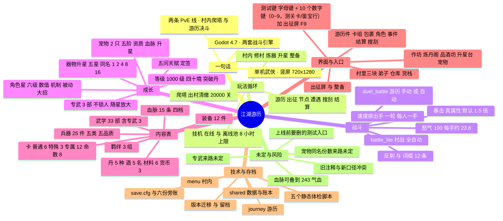

# 江湖游历 · 思维导图

> 单机武侠 · 竖屏手游（720×1280）· Godot 4.7 · 项目根 `D:\1\wuxia-demo`
> 用法：① 下面那张 Mermaid 脑图在 Typora / Obsidian / VS Code（Markdown Preview Mermaid 插件）里能直接渲染；
> ② 「大纲」一节是从同一份内容展开的完整版，任何编辑器都能读；
> ③ 同目录 `游戏思维导图.opml` 可以直接拖进 XMind / 幕布 / FreeMind / MindManager 变成可编辑脑图。
> 数字都是从表里数出来的（不是估的）；末尾附「未定与风险」，逐条给行号。

---

## 一图总览（Mermaid）



---

## 大纲（完整版）

### 0. 一句话与骨架
- **游戏**：单机武侠养成 + 两条 PvE 线；竖屏 720×1280，Godot 4.7
- **两条线**：
  - **村内爬塔**（出村清缴）：全自动战斗，`menu/battle_lite.gd`
  - **游历决斗**：手动出牌 / 自动二选一，`journey/duel_battle.gd`
- **一句循环**：修村 → 炼器炼丹升星 → 整备出征 → 游历（或爬塔）带资源回村 → 修村
- **三个可玩角色**：少侠（剑）、陈石（枪·断枪只是标签）、苏青鸾（匕首）
  - 入手：少侠开局就有 · 陈石＝引子走完 · **苏青鸾＝通关第 150 关触发「女侠」剧情入队**
  - ⚠ 四段"挂关号"的剧情（藏宝图 50 · 女侠 150 · 灵草 300 · 货仓 400）**文案里不写死数字**：
    第一句用 `{N}` 占位，由 `menu_sketch._story_pages()` 按 `GameState.STORY_*_STAGE` 现算
- **两只宠物**：白狐（护主·气血%）、青隼（速度%）

### 1. 玩法循环
- **村内段**
  - 修村：村况 5 段（焦土 → 立木 → 成屋 → 炊烟 → 桃花），`menu/data_build.gd STAGE_MAX=4`
  - 起建筑：藏宝阁（通关 50 关触发）→ 山洞 → **百工坊**（v50：品酒/炼丹/鉴宝三合一；屋 8 木料，丹房再 10 木料、要过 300 关）
  - 造物：炼丹阁（5 种丹 ＋ **突破丹五品**，**v41 起多炉**：同类型可一次炼多颗；想同时炼不同方子要花银两开炉位
    2000/6000/16000/40000，按钮就在炼丹窗口里）· 品酒坊（酿酒/卖酒）· 仓库（残页合成）· 鉴宝行（看仓/买仓）
  - 炼丹阁 **v6 流程**：点［炼制丹药］→ 弹窗里 **① 选丹药 ② 填/选颗数（可直接敲数字，1~5）③ 开始炼丹**；
    主面板的炉位是**一行一炉**：已开的写"「xx丹」×N 正在炼制 · 剩 …"，没开的写"**未解锁 · 需要 N 银两**"＋［开炉位］
    - ⚠ v44 修：读档时原来有一处遗留的调试重置（`furnaces = []` / `furnace_slots = 1`），
      每次进游戏都把**买过的炉位和正在炼的那几炉一起清掉**——已删；炉位只由 `furnace_unlock()` 涨
  - 整备：弟子面板（属性/天赋/装备/武学/角色星）· 整备面板（站位＝出手顺序）
- **爬塔段**：出村面板选关 → battle_lite 自动打 → 银两/经验/首领赏
- **游历段**：出征屏（选人 / 选路 / 携宠 / 临时仓库 / 命数）→ 游历舞台逐节点推进 → 结算带回
- **挂机**：在线＋离线同一个池（上限 8 小时）· 自动爬塔两形态（屏幕内连打 / 回村后台估算）

### 2. 战斗
- **两套引擎，别混**
  - `menu/battle_lite.gd`：村内爬塔/清缴，**全自动**，不吃运签卡
  - `journey/duel_battle.gd`：游历决斗，**手动（出牌）或自动**，吃运签卡
  - 同一个 `journey/stick_fighter.gd` 演两边的小人（火柴人 + 姿态弹簧 + 位移补间队列）
- **出手**：按速度排序；**一轮 ＝ 全员各出一次手**；一手 `STEP=0.72s`
- **怒气**：上限 **100**；每手 `34 × 0.7 ≈ 23.8`（引气归元 ×1.3）
- **伤害**：普攻倍率 `DMG_MUL=2.0`；大招基准 `ULT_MUL=2.5`
- **暴击＝真属性**：倍率 `1.0 + 暴伤/100`，默认 50 → **1.5 倍**（旧版写死 1.6）
- **v48：增幅的叠加口径，一张表说清**（用户："增幅都是线性叠加的吧…看看计算方式"）

  | 层 | 谁 | 怎么合 |
  |---|---|---|
  | ① 基础层 | 升级 / 丹药 / 突破 / 根骨补课 直接写进 `role.stats` | **相加** |
  | ② 件层 | 兵器 / 护甲 / 玉佩 / 披风 / 武学的 `item_stats` | 每件先按**自己那把的星** ×(1+0.2×星)，再**逐件相加** |
  | ③ 全队层 | 宠物护主%（气血）/ 青隼%（速度）、羁绊 `pct_all`＋`flat` | 宠物是**单独一层乘**；羁绊**先乘百分比、再加平面值** |
  | ④ 战斗层 `tfx` | 五问天赋 ＋ 角色星 `stat` ＋ 专武常驻 `fx`（随星放大） | 同键**相加**成一个桶，再按下面折 |
  | ⑤ 出手乘区 | 招式倍率 / `DMG_MUL` / 暴击 / 攻防对拼 / 护体 / 加持 / 自带增伤 | **逐层相乘**（各自独立） |

  - **`dmg`（伤害加成%）是"加成一个数、只乘一次"**：装备 +20% 与星 +8% ⇒ **+28%**，不是 ×1.2×1.08
  - **暴伤**同理**相加**（50＋18＝68 → 1.68 倍）；只有角色星「凝息」`crit_mul_up` 是**乘**（1.68×1.5）
  - 唯一的例外：天赋「剑心通明」`art_dmg` 是**独立乘子**（剑/空手时再乘一道）
  - 运签卡：**同键请几张叠几份**（相加）；只有 `poison_hit`（布尔）/`vengeance`（封顶 20%）/`art_cd_minus`（封顶 2）再请没用
  - **减伤多层是相乘不是相加**：护体 × 加持 × 残血 …… 其中"加持 vs 专武大招减伤"取最大
  - ⚠ 三条口径的**唯一真源**：`GameState.panel_stats`（面板）、`GameState.combat_tfx / combat_mech`
    （战斗与估算共用）、`GameState.formation_dps_est`（离线估算）——**别再各拼各的**
- **v48：查账查出来的七处"两边不一样"，已全修**（用户："全修"）
  1. **游历里我方的防御/闪避以前根本没接线**（`_setup_ally` 只抄了 atk/dmg/spd/crit）——
     披风/护甲的防闪、羁绊的防、天赋「身轻如燕」在游历里全是白搭，而村内生效
     → 现在抄进去了；实测：怪攻 12 打陈石防 11，落 100 → **52**；闪避 40 实测 200 次闪 60 次
  2. **怪护体**：村内按"原始数"算（顺手把攻防对拼与洞察那份抹掉了），游历按"折后数"——
     → 统一成**折后数相乘**；实测 raw 1000＋防御对拼 → 882 → 护体 ×0.78 → **688**（旧写法 780）
  3. **村内武学不带出手人**（`_e_take(x)` 没传 src）→ 跳过攻防对拼、也不会被反伤/战意/电盾碰上
     → 三条支路都传上；实测怪防 100 时武学伤害从 120 降到 **30**（挡 75%），带反伤的怪能弹到我
  4. **游历"只剩一个敌人"时大招增伤被丢掉**（`mult = solo` 覆盖了刚乘过的 `ult_dmg`）
     → 改成 `solo × (1+ult_dmg)`（破军卡/星「破浪」的 +30% 不再白给）
  5. **宠物护主气血% 在出村战斗里算了两遍**（面板 164、打起来 197）→ 只算一次
  6. **弟子面板整层漏算 tfx**（天赋/角色星/专武写的 +15% 伤害、+12% 气血、+6 暴击…面板一个都不显示）
     → 新增 `GameState.panel_stats`：面板写的数**就是战斗用的数**（实测面板 197 ＝ 战斗 197）
  7. **离线挂机估算**漏算专武被动、减伤写的是"取最大"、暴击用一个固定 ×0.6 系数
     → 走 `combat_tfx`、减伤改逐层相乘、暴击按**真暴伤**折算（实测带专武 dps 141.8 → 146.8）
- **v48：武学按 `target` 打（村内以前完全忽略这个字段）＋ 多段武学**
  - `front/mid/back` **真的会"绕过去"**：在够得着的排里挑**站得最靠后**那只
    （与苏青鸾「洞察」`row_priority: back` 同一条规矩）；实测穿云箭法（打后排）只打到后排那只
  - `sweep` 在村里也真的**打全体**了（以前只打最前排——而游历早就是群攻）
  - **多段武学**（新字段 `"hits"`，**2~3 段**）：每段**各自掷暴击、各自过一遍结算**，
    每段暴击都触发"只要暴击就追击"那一套 → 它的价值是**多几次暴击机会**，不是总倍率
  - 绕后那门**降了倍率、也减了数量**：穿云箭法 1.9 → **1.35**；燕子三抄水从 `back` 改成 `mid`
    （"绕后"从此只有一门，是稀缺手段）
  - 新增四门多段（每段倍率都很低）：连环三击（良品·3 段 ×0.42）· 柳叶双刺（良品·2 段 ×0.6）·
    乱披风（上品·3 段 ×0.55）· 暴雨梨花（极品·3 段 ×0.68）
  - 实测（游历真打一场）：连环三击战报写「第 1/3 段 14 · 第 2/3 段 21（暴击）· 第 3/3 段 22（暴击）」
- **v47：所有"减伤比例"一律砍到原值的一半以下**（用户："减伤比例太高了，削弱所有的减伤比例，包括角色的，至少砍一半，我要准备做多元素了"）
  - 护体武学：铁布衫 45%→**22%** · 金钟罩 50%→**25%** · 金刚不坏 55%→**27%** · 玄武神功 65%→**32%**
  - 加持减伤：坚壁旗令 30%→**15%** · 铁壁合围 40%→**20%** · 同心结阵 18%→**9%**
  - 角色：陈石「扎马稳桩」12%→**6%**（第 4 星「稳桩」跟着变成 6%→9%）· 星「铁骨」6%→**3%** ·
    铁壁桩功大招窗口 15%→**7.5%**
  - 天赋/卡：百折不挠 20%→**10%** · 逢凶化吉 6%→**3%** · 磐石卡 8%→**4%**
  - 怪的护体：横练/铁堡/金钟/寨门/按兵不动 45%→**22%** · 龟息/坐镇/横练（游历）50%→**25%** · 背崖而立 40%→**20%**
  - ⚠ 顺手修了一个真会咬人的坑：**被动/大招/自带技是存在 role 字典里随存档落盘的**——
    改表里的数值，老档读回来还是旧的（陈石那次实测仍旧吃 12%）。现在读档时按模板**整块刷正**
    （`GameState._sync_role_kit`，与 `_sync_role_innate` 同一口径）
  - ⚠ **防御那条没动**：`防御 ÷（对手攻击＋防御）` 是"两个数值对拼"，不是固定减伤率——
    它也正是以后"多元素"要按类型分叉的地方（见 `game_data.GameData.def_cut` 那段注释）
- **反刺/反伤**：陈石枪势按自己气血上限 8%~12%（挨得越重越高）；词缀反伤一次封顶 10%
- **敌人词缀 12 条**：反伤 / 速攻 / 回春 / 自爆 / 电盾 / 狂暴 / 鼓舞 / 战意 / 毒刃 / 破前 / 偷袭 / 截后
- **站位与范围**：`target` 8 种（front/mid/back/sweep/ally_front/ally_mid/ally_back/ally_all）
  - **v46：怪也讲站位了**——**前排肉 / 中排均衡 / 后排高伤**（`game_data.FOE_ROWS`）：

    | 排 | 血 | 攻 | 防 | 谁站这儿 |
    |---|---|---|---|---|
    | 前排 | ×1.00 | ×0.42 | ×1.35 | 盾手（替本体挡刀，打得最轻） |
    | 中排 | ×0.62 | ×0.62 | ×1.05 | 刀手 |
    | 后排 | ×0.38 | ×0.96 | ×0.75 | 杀手（**打得疼、挨不住**——先斩它） |

  - 站位型（`GameData.foe_archetype`，按关号/敌人数现算，**同一场重打是同一套**）决定**首领/精英自己**站哪一排：
    0 肉盾（站前排）· 1 均衡（站中排）· 2 高伤（躲后排）——副手补剩下的位置、名字带「盾手/刀手/杀手」
  - ⚠ **整组的总血池与总攻击跟旧口径一模一样**（旧表 本体 1.0 ＋ 中排 0.6 ＋ 后排 0.4；新的走
    `foe_row_plan` 归一，三人组仍是 2.0×、两人组 1.6×、单人 1.0×）——难度不变，
    变的是"谁挡在前面、谁最疼、先打谁"；离线爬塔估算（`foe_hp_scale`）因此一个字不用改
  - 于是**苏青鸾的作用显出来了**：她持匕首时自带「洞察」普攻绕前排直取后排，
    而"后排杀手"正是打得最疼的那一只；带 `target: back/mid` 的武学同理
  - 战报开场与［敌情］面板都会把这一组的站位（含各只的气/攻）列出来
  - **v47：单人关也有"体型"**（占清关的 **88%**——每 10 关 1 个精英、每 25 关 1 个首领，其余都是单怪）：

    | 体型 | 血 | 攻 | 防 | 手感 |
    |---|---|---|---|---|
    | 肉盾 | ×1.15 | ×0.88 | ×1.15 | 血厚、打得轻——拖得住就赢，怕输出不够 |
    | 寻常 | ×1.00 | ×1.00 | ×1.00 | 原样（这一档什么也没动） |
    | 高伤 | ×0.86 | ×1.16 | ×0.88 | 打得疼、不经打——先手、先控、先回气值钱 |

    - 按**关号每关轮换**（肉盾 → 寻常 → 高伤 → …），同一关重打永远是同一个体型
    - ⚠ **血×攻的乘积不变**（1.15×0.88 ≈ 1.012、0.86×1.16 ≈ 0.998）→ 难度大致不动，变的是"该怎么打"
    - ⚠ **离线挂机估算知道这件事**：`GameData.foe_stage_scale(关号, boss, elite)` 是两处共用的那一口
      （真战斗与 `Tower.run_offline` 都读它），所以挂机算出的关卡数跟手动打仍然对得上
    - ⚠ **游历的引子趟强制"寻常"**：那是全游戏第一场仗（教学关），不该一上来就撞肉盾/高伤
    - 战报与［敌情］会写这一只是什么体型（寻常那档不解释，免得啰嗦）
- **v46：怪的技能/大招倍率整体下调约 25~30%**（用户："爬塔和游历的怪技能和大招倍率降低"）
  - 爬塔：前 50 关首领招 1.2~1.8 → **0.9~1.35**（连追那两段一起压：1.3+0.9 → 1.0+0.65）；
    大招 2.0~2.5 → **1.5~1.8**；50 关后模板招 1.35~1.85 → **1.05~1.4**、模板大招 2.5~2.7 → **1.8~2.0**
  - 游历：精英招 1.3~1.9 → **1.0~1.4**、boss 招 1.7 → **1.25**、boss 大招 2.5 → **1.8**
  - 理由：怪的招比玩家的武学还重，堆了防御/站位也扛不住"一发大招半条命"。**只动怪的表**，
    玩家武学（`data_cards`）一个字没碰
- **v46：苏青鸾的暴击追击＝只要暴击就追**（用户："只要暴击就追击，释放技能和大招也是哈"）
  - 原来这块只长在**普攻**那一支里 → 现在抽成一口（`battle_lite._song_follow` / `duel_battle._song_follow`），
    **普攻 / 武学 / 大招**三条路都调它
  - 顺带补上：出村战斗的**武学以前根本不掷暴击**（只有普攻与大招掷）——现在武学也掷了，
    不然"武学暴击追剑"无从谈起
  - 窗口与段数仍由大招「青鸾出岫」设（`turns` 3 手 · 角色星「出岫」再 +1 段 · 引吭卡再 +1 段）；
    追剑自己也会掷暴击（专武·短歌行：追击 +50%、追击暴击再 +20%）
  - 实测（把暴击拉到 100% 对满血首领）：武学必暴击 → 追剑 1 句；必不暴击 → 0 句；窗口没开 → 0 句；
    `hit` 大招必暴击 → 追剑 1 句；`song` 大招开窗后再放武学 → 追剑 1 句
  - **v49（用户："追击的暴击不触发追击"）：追剑自己暴击 → 再追一层**（连环）
    - 以前追剑把暴击只换成伤害（专武·短歌行那条 +20%），不会再生出追击——
      "只要暴击就追击"这句话在**追击自己身上**不成立
    - ⚠ **有上限**：`SONG_CHAIN_MAX = 3`（一次触发最多追到第 3 层；1 ＝ 老行为）。
      期望追击次数 ＝ p + p² + p³（苏 27% 暴击时约 0.36 次/触发），不会"一暴击就无限连环"
    - 实测：暴击拉满 → 三句追剑（`（暴击！）` / `（暴击！）（连环 2）` / `（暴击！）（连环 3）`）；
      27% 暴击 60 次触发 → 1 层 41 · 2 层 17 · 3 层 2
- **大招形态**（决定能吃什么加成）
  - 少侠「长风破浪」＝ `hit` 瞬发群攻（只能吃倍率/开怒）
  - 陈石「回马断枪」＝ `aura`（能吃持续/反刺）
  - 苏青鸾「青鸾出岫」＝ `song`（能吃持续/追击）

#### v52 负面状态（用户："参考三国志谋定天下这款 SLG，我要加一些负面状态，类似缴械啊、燃烧啊 等"）
- **唯一真源＝`shared/data_status.gd`**（新建）：一张表 ＋ 六个 API，**两套引擎都只调这几个口**，
  引擎里不许再写死状态名。状态挂在**单位字典**的 `u["status"]`（结构 `{"burn": {"n": 层, "t": 剩几手}}`），
  出村是 `_party[i]` / `_foes[i]`，游历是 `_allies[i]` / `_cur()`——**同一个键名**
- 七条状态（当前全是对面吃、自己吃的）：

  | 状态 | 效果 | 默认时长 | 叠加 |
  |---|---|---|---|
  | 燃烧 | 每手掉**气血上限 3%/层**（掉血**不吃减伤**，与毒/自爆同口径） | 3 手 | 加法，上限 3 层 |
  | 缴械 | **不能普攻**（武学与大招照放；两手都空就格挡） | 2 手 | 只刷新时长 |
  | 震慑 | **这一手整个不出**（挨打照旧） | 1 手 | 只刷新时长 |
  | 破防 | 挨打时受伤 **+30%/层** | 3 手 | 加法，上限 2 层 |
  | 虚弱 | 出手伤害 **−25%/层** | 3 手 | 加法，上限 2 层 |
  | 迟缓 | 出手顺序用的速度 **−30%/层** | 3 手 | 加法，上限 2 层 |
  | 禁疗 | 回血**一律无效**（回气诀/加持回春/枪势回气/怪的回春） | 2 手 | 只刷新时长 |

- **口径（两套引擎必须一致，写进 `data_status.gd` 头部）**：
  1. **结算时机＝该单位自己出手之前**：先看 `skips()` **再** `tick()`——顺序反了震慑就永远不生效（踩过）；
     然后掉血、掉时长、到 0 摘掉，最后才出手/跳手。跟既有的"毒发"是同一个位置。
  2. `atk_mul`（虚弱）挂**出手方**、`taken_mul`（破防）挂**挨打方**，两者在**攻防对拼之前**相乘
     （出村挂在 `_e_take` / `_member_take_cut` 的最前头；游历挂在 `_foe_take` / `_p_mitigate` 一路）
  3. `spd_mul`（迟缓）只影响**出手顺序**，不改 `spd` 本身（不然会跟加持/还原打架）
- **来路**（三条，前两条两套引擎都认）：
  - **武学 6 部**（`data_cards`，`apply` 字段；倍率刻意压到同档的六~七成——状态本身就是收益）：
    烈焰刀(燃烧, 良·×1.6) · 软筋散(虚弱, 良·×1.2) · 卸甲手(缴械, 上·×2.4) · 摄魂音(震慑 75%, 上·×1.8) ·
    裂石拳(破防 2 层, 极·×3.2) · 缠丝腿(迟缓, 极·×2.9)
  - **怪词缀 2 条**（`data_affixes`，`ON_HIT` 表，**第 4 章/7 档起**才进池）：火魔（击中就上燃烧 1 层）·
    铁锁（击中 40% 上缴械）
  - **首领招数**（`tower`，**第 50 关往后**的模板池）：焚身掌(燃烧) · 锁脉手(缴械) · 封穴指(禁疗) ·
    大招 焚天一击（横扫全场，人人燃烧 2 层 = 每手 6% 上限）。**前 50 关一个字没动**（教学段不给玩家上状态）
- **看得见**：出村——首领血条正下方一行"负：燃烧2 · 缴械"，我方每人名字下面 12 号小字；
  游历——血条那一行本来就是"名字＋气血＋加持标记"，状态就并排缀在后面（单人那句与多人那句都加了）
- **小图标（v54，用户："记得负面的小图标也得有"）**：`shared/status_chips.gd`——**纯代码绘制**的小方块，
  一块一个字（燃／械／默／招／震／破／弱／迟／挫／滞／窍／脉），底色＝那条状态的颜色，
  **>1 层时在右上角挂一颗小徽章写层数**（画在块外、不压字），画不下时收尾一个"…"
  - 位置：出村——我方每人血量文字右边（8 块）、首领血条右边（5 块）；游历——两边血条底下各一排（各 13 块）
  - 字体用项目那份楷体（`assets/fonts/lxgw_wenkai.ttf`），与手绘文字同一份，不会出豆腐块
  - 没有负面时整排自动隐藏（`count()==0`）
  - ⚠ 无头探针只能验"数据与接线"（哪几条、什么字、什么色、位置、显隐），**像素外观要你自己在游戏里瞄一眼**
- **实测**（**只读探针，存档 MD5 前后一致**）：
  - **出村**：燃烧 2 层每手掉 **9**（上限 150 的 6%）、3 手到期、连上 3 次封顶 3 层；
    首领挨 1000 → 干净 **909** / 我虚弱1层 **682**（×0.75）/ 首领破防1层 **1182**（×1.3）；
    我方挨 1000 → 干净 **444** / 怪虚弱 **333** / 我破防 **578**；缴械：我方普攻 **38 → 0**、首领普攻 **7 → 0**；
    震慑：整手 0 伤害且 1 手后自动散；迟缓把出手顺序 `["0","e0"]` 翻成 `["e0","0"]`；
    禁疗：回气诀 **25 → 0**；烈焰刀命中即上燃烧；词缀 30 次内必挂上；
    另跑了一轮 **40 手冒烟**（把双方血量拉高、谁也不死）：全程无报错，燃烧叠到 3 层、
    首领大招「焚天一击」横扫给全队上 2 层、缴械反复续上
  - **游历**：燃烧在**两边**都对（我方 3 层每手 **−18000**＝200000 的 9%、首领 1 层每手 **−36000**＝1200000 的 3%）；
    首领挨 1000 → 干净 **543** / 它破防 **706**（×1.3）；我方挨 1000 → 干净 **857** / 怪虚弱 **643**（×0.75）/ 我破防 **1114**（×1.3）；
    出手速度 干净 **10** → 迟缓2层 **4**（×0.4）；战报里实测到"兵器被打落（普攻递不出去）4 次"、
    "被震慑——这一手整个没使出来"、"经脉被封——这一手的回气全落空"各若干次

#### v52 顺手修掉的两个老 bug（都在两套引擎里，用户没提、是查状态时撞见的）
- **① 加持的减伤算反了（整整强五倍多）**：武学表里 `kind:"bless"` 的 `cut` 是**伤害系数**
  （`art_aegis` `cut = 0.85`＝减伤 15%，描述与 `游戏思维导图` 第 153 行都写 15%）；
  可 `_bless_apply` / `_cast_bless` 把 `cut` 原样存进 `bless_cut`，消费者却是 `dmg × (1 − bless_cut)`——
  于是 0.85 变成"减 85%"。**实测：坚壁旗令 1000 → 150（应 850）· 铁壁合围 1000 → 200（应 800）·
  同心结阵 1000 → 90（应 910）**。修法选在**源头转换**（存进去的就存"减伤比例" `1 − cut`）：
  消费者一个字不用动，与专武·铁壁桩功的 `ex_ult_cut` 取 max 也从此同口径，`_bless_mark` 印出来的自然对。
  修后实测 **850 / 800 / 910**（两套引擎都量过：游历 1000 → **850**），战报也印"减伤 15%"。
  ⚠ **这是把玩家变弱的一处修正**（原来白多吃 70% 减伤）
- **② 三处武学描述与数值对不上**（v51 压过数值、文案没跟着改）：锐锋旗令 +35%→**+25%** ·
  同心结阵 伤害 +18%/暴击 +8 → **+13%/暴击 +5**（减伤 9% 本来是对的）· 专武 长风诀 出手伤害 +8%→**+5%** ·
  专武 短歌行 暴击 +8%/暴伤 +20% → **+5%/+13%**

#### v53 负面状态第二轮（用户："驱散可以加 还有削弱怒气啊 禁止技能释放的啊 禁止大招释放的啊等 还有禁止被动的啊 技能冷却延长的啊 若有负面每一种受到伤害增加的啊 禁疗别百分百吧 60%-80% 就行"）
- **表长到 12 条**（`shared/data_status.gd`，两套引擎共用；新增的都是"限制出手"与"削数据"两类）：

  | 状态 | 效果 | 时长 | 叠加 | 谁上的 |
  |---|---|---|---|---|
  | 燃烧 | 每手掉上限 **5%/层**（最多 **2 层**、只烧 **2 手**） | 2 手 | 加法 ≤2 层 | 烈焰刀 · 火魔 · 焚身掌/焚天一击 |
  | 缴械 | 不能**普攻**（武学/大招照放） | 2 手 | 只刷新 | 卸甲手 · 铁锁(40%) · 锁脉手 |
  | **沉默** | 不能放**武学**（普攻/大招照放） | 2 手 | 只刷新 | 封喉指 · 首领·闭气针 |
  | **封招** | 放不出**大招**（怒气照样攒，满了也放不出来） | 2 手 | 只刷新 | 断势拳 |
  | 震慑 | **整手不出** | 1 手 | 只刷新 | 摄魂音(75%) |
  | 破防 | **挨打受伤 +30%/层**（＝你说的"受到伤害增加"那一条） | 3 手 | 加法 ≤2 层 | 裂石拳(2 层) |
  | 虚弱 | 出手伤害 −25%/层 | 3 手 | 加法 ≤2 层 | 软筋散 |
  | 迟缓 | 出手顺序速度 −30%/层 | 3 手 | 加法 ≤2 层 | 缠丝腿 |
  | **挫锐** | 上手**当场打掉 30 点怒气**，此后怒气获取只剩**四成** | 3 手 | 只刷新 | 泄气散 · 首领·泄气掌 |
  | **滞涩** | **技能冷却 +2 手**（当下在冷却的一起往后推，期间新放的也 +2） | 3 手 | 只刷新 | 滞气针 |
  | **闭窍** | **被动全失效**——**这一条是冲着玩家来的**（见下面 v54）：自带天赋 / 被动功法（专武）/ 五问天赋 / 角色星 全被压住 | 3 手 | 只刷新 | **只有首领**：出村 50 关后的「点窍手」· 游历断魂崖剑客 / 黑风左使 / 寨主 |
  | 封脉 | 回血**只剩三成**（v52 叫"禁疗＝完全回不上"，按"60~80% 就行"改成 **−70%**） | 2 手 | 只刷新 | 封穴指 |
- **燃烧与中毒分家了**（用户："燃烧要做区分"）：燃烧是**急火**（5%/层 · 2 层 · 2 手，一口就是一口），
  中毒是**细水长流**（3%/层 · 3 层 · 3 手，毒刃词缀那条，见 `data_affixes.POISON_*`）——
  两条都按上限百分比直接扣、都不吃减伤，但一条求爆发、一条求续航
- **驱散（新）**：武学「清心诀」（`kind: "cleanse"`）——自己这手不出击，**全队各随机洗掉身上一条负面**，
  并**磕掉当前对手的护体与蓄势**。⚠ 用独立的 `cleanse` 类型而不是"bless + 字段"：
  加持那一套会 `_bless_clear` 顶掉旧的加持，清心诀不该顺手把队友的坚壁洗掉
  ⚠ v54（用户："洗掉所有负面 改为随机一个"）：**原来是"洗掉全部"，现在只随机洗一条**
  （`St.cleanse` 先随机挑再洗，`cleanse: 1`）——所以它**不保证**洗得中你最想洗的那条：
  身上挂三条时洗到「闭窍」的几率是三分之一（实测 60 次里 19 次，约 1/3 ✓）
- **新增武学 5 部**（封喉指·沉默 / 泄气散·挫锐 / 断势拳·封招 / 滞气针·滞涩 / 清心诀·驱散），
  武学总数 **39 → 44**；首领模板（第 50 关往后）**再 +3**：闭气针（沉默）· 泄气掌（挫锐）· 点窍手（闭窍）
- **控制类的底线**：一场首领最多同时压住"普攻 / 武学 / 大招"里的**两样**——首领只带 2 门招
  （模板池按 `ti` 与 `ti+2` 取），玩家手里**永远还剩一条路**，不会被彻底锁死
- **实测**（只读探针，存档 MD5 前后一致）：
  - 出村：燃烧 2 层每手 **16**（上限 156 的 10%）、**2 手到期**；封脉 回血 **25 → 8**；
    沉默→战报从"施『烈焰刀』"变成"出手"（普攻）；封招→大招没放、**怒气留着 131**（没封时放完清零）；
    挫锐 怒气 **60 → 30**、一手涨的怒气 **31 → 12**（四成）；滞涩 当前冷却 **3 → 5**、
    放完新设的冷却 **4 → 6**；闭窍 `_e_affixes()` **3 条 → 空**（这一版还把闭窍做成了"压首领词缀"，v54 已改）；
    清心诀洗负面 + 磕掉首领**护体与蓄势**。另跑 **50 手冒烟**（第 62 关首领、双方血量拉高）：无报错，
    我方给首领挂上 **封招/挫锐/沉默/滞涩/燃烧/闭窍**，首领给我方挂上 **燃烧2/缴械/沉默/挫锐**
  - 游历：牌面数 干净 **4** → 沉默 **2**（武学两张没了）→ 封招 **3**（大招没了）；挫锐 怒气 **100 → 70**；
    滞涩 冷却 **3 → 5**；封脉 `heal_mul` **0.3**；闭窍 `_foe_affixes()` **3 条 → 空**；
    清心诀 洗掉 **燃烧2·沉默·封脉** + 磕掉首领护体/蓄势

#### v54 闭窍改成"冲着玩家来"（用户："闭窍是针对玩家的"）
- 上一版把「闭窍」做成了**玩家打给首领**（压掉它的词缀），理解错了——现在改成：
  **只有首领会给玩家挂**，压的是**玩家这一侧的四条被动线**：
  - **自带天赋**（断枪反刺 / 洞察绕前排与残敌增伤 / 赤子之心…）
  - **被动功法**（专武：长风诀 / 铁壁桩功 / 短歌行）
  - **五问天赋**（百折不挠 / 剑心通明…）
  - **角色星**（猎影 / 凝息 / 铁桩 / 破浪 / 武学宗师…）
- **来路**（都只在首领侧）：出村第 50 关往后的模板「**点窍手**」· 游历的**断魂崖·剑客 / 黑风左使 / 寨主**
- **玩家的解法**：「**清心诀**」（驱散）——洗掉负面时被动立刻还原
  ⚠ 但 v54 起清心诀只**随机洗一条**：身上挂三条时洗到闭窍的几率约三分之一，**不是稳定解法**
- **实现**＝**备份 — 压零 — 还原**（`battle_lite._passive_mask` / `duel_battle._passive_mask`）：
  能压的字段在两张清单里（`PASSIVE_ZERO` ＋ 游历的 `PASSIVE_FX_KEYS`），
  压着期间不重复备份（所以"续上"不会把已压成 0 的值当成原值），
  到期或被洗掉时 `_passive_unmask()` 原样还回
  - ⚠ **还不了的那一份**：已经算进**气血上限**的被动（自家 hp_pct、星的气血）——**血条不会缩**，写进说明里了
  - ⚠ 游历的 `ult_dmg`、`art_cd_minus` 这类键**卡与被动共用**（破军卡 / 冰心卡）——
    闭窍压被动时那一份卡收益也一起停，分不开，注释里写清了
- **删掉了**上一版那门玩家用的「封脉指」（武学 45 → **44**）
- **实测**（只读探针，存档 MD5 前后一致）：
  - **出村**：挨一记『点窍手』后 `thorn_mul 1.15→1.0`、`foe_low_mul 1.25→1.0`、`talent_cut 0.10→0`、
    `rage_mul 1.40→1.0`、`cut 0.06→0`、`row_prio "back"→""`、`crit 22→19`、`def 17→15`、`dodge 13→11`、
    星与专武那批（`star_crit_low 30→0`、`star_critmul 0.35→0`、`star_follow 1→0`、`star_anyw true→false`、
    `ex_follow 0.35→0`、`ex_ult_cut 0.075→0`）、`ult_mult 2.6→1.7`、`ult_turns_max 4→3`；
    **三手之后逐项还原**（1.15 / 2.6 / 22 都回来了），**清心诀洗掉也立刻还原**
  - **游历**：`fx_buff` **6 键 → 1 键**（5 条被动键摘掉，卡那条 `vengeance` 留着）、
    `talent_wpn 1.15→1.0`、`rage_mul 1.4→1.0`、`inn_thorn 1.1→1.0`；三手后与洗掉后都**整份还原**；
    残血时出手 40 次的均值 **31.6 → 21.3**（−33%：自带「赤子之心」+25% 与天赋「剑心通明」+15% 一起停）

#### v54 全局规则：负面越多越疼（用户："全局规则——身上每挂一条负面，挨打就多受一点伤"）
- **每挂一条负面 → 挨打时受伤 +4%**，最多算 **5 条**（**封顶 +20%**）
  （两个常量 `PER_BAD_TAKEN = 0.04` / `BAD_TAKEN_CAP = 0.20` 在 `data_status.gd` 里，改数只改这两行）
- **按条数算，不按层数**（燃烧挂到 3 层也只算"一条"）
- **与「破防」叠加**：破防是那一条自己额外给的 +30%/层，全局这条是"负面条数"的底账
- ⚠ **掉血类不走这一条**：燃烧 / 中毒 / 自爆 仍然是"按上限百分比直接扣、不吃减伤"，与条数无关
- **两套引擎自动全吃到**：它写在 `data_status.taken_mul()` 里，而
  出村 `_e_take` / `_member_take_cut`、游历 `_foe_take` / `_p_mitigate` 四个挨打口读的都是这一口
- **看得见**：状态那一行后面会缀上"（受伤 +20%）"（出村首领血条下那行、游历血条那行、出村［敌情］面板）
- **实测**（只读探针，存档 MD5 前后一致）：
  - 出村 我方挨 1000：0/1/2/3/5/7 条 → **1000 / 1040 / 1080 / 1120 / 1200 / 1200**（第 5 条就到顶）
  - 出村 首领挨 1000：0/2/4 条 → 909 / 982（×1.08）/ 1055（×1.16）
  - 与破防叠加：干净 909 → 只上破防1层 **1218**（×1.34 ＝ 破防 1.30 × 全局 1.04）
  - 掉血类不受影响：燃烧 2 层每手掉 **16**（上限 156 的 10%），再挂两条负面之后**还是 16**
  - 游历 我方挨 1000：0/2/4/6 条 → **1000 / 1080 / 1160 / 1200**；首领挨 1000：0→3 条 **543 → 608**（×1.12）

#### v55 新词缀：14 条 → **25 条**（用户："新词缀 也可以加上了"）
- **分四池**（池子越大每条越难撞见，所以按"第几章/第几档"分开摆）：

  | 池 | 条数 | 出村 | 游历 | 内容 |
  |---|---|---|---|---|
  | 早 | 3 | 第 1 章 | 3~4 档 | 回春 · 速攻 · 反伤 |
  | 中 | +3 | 第 2~3 章 | 5~6 档 | 鼓舞 · 毒刃 · 电盾 |
  | 晚 | +5 | 第 4~5 章 | 7~8 档 | 火魔 · 铁锁 · **锁喉 · 软筋 · 缠足** |
  | 硬 | +14 | **第 6 章起**（31 关） | **9~10 档** | 自爆 · 狂暴 · 战意 · 破前 · 偷袭 · 截后 · **裂甲 · 泄气 · 滞脉 · 封穴 · 点窍 · 吸血 · 坚壁 · 回响** |

- **八条"击中就上状态"的新词缀**——**两套引擎一个字都没改**：词缀表里加一行 + `ON_HIT` 表里写"上哪条状态"，
  两套引擎的 `_st_affix_hit()` 本来就是"遍历身上的词缀 → 查 ON_HIT → 上状态"，所以自动全通：
  锁喉(35% 沉默) · 软筋(虚弱) · 缠足(迟缓) · 裂甲(破防) · 泄气(50% 挫锐) · 滞脉(50% 滞涩) · 封穴(30% 封脉) · 点窍(20% 闭窍)
- **三条机制类**（这两个引擎各接了一处）：
  **吸血**＝每击中一次回自己上限 **6%**（打得越久它越精神）· **坚壁**＝挨打 **25% 几率只吃两成**（不做"完全免伤"：
  战报里会飘 −0，而且"是否命中"会串味）· **回响**＝每第 2 手追一记**四成力**快招（与速攻错开：那条是每第 3 手六成力）
  - ⚠ 回响和速攻一样，只在**普攻那一手**结算（放招/放大招那一手不追）——与既有的速攻同一条口径
- **挂机估算跟着补**：`Tower.pressure_mul` 给 11 条新词缀各加了压力权重（点窍/吸血/回响 +0.10 最狠，缠足 +0.04 最轻），
  免得又出现"挂机过了、手动打不过"
- **实测**（只读探针，存档 MD5 前后一致）：
  - 分池：第 1 章 3 条 / 第 3 章 6 条 / 第 5 章 11 条 / 第 6 章 25 条；游历 3 档 3 / 5 档 6 / 7 档 11 / 9 档 25 ✓
  - 八条上状态的（每条打 40 次）：锁喉 **15/40**（35%）· 软筋 40/40 · 缠足 40/40 · 裂甲 40/40 ·
    泄气 **22/40**（50%）· 滞脉 **21/40**（50%）· 封穴 **16/40**（30%）· 点窍 **5/40**（20%）；
    战报原文如"少侠 中招：「挫锐」1 层 · 再 3 手"＋"　锐气被打散：怒气 −30"
  - 吸血：首领 81 → **91**（上限 162 的 6% = 10）· 坚壁：40 次挨打里硬挡 **8** 次（期望 10）·
    回响：4 手追 1 记（那 4 手里有放招的手，只有普攻手才算）· 游历 16 秒实战：战报里出现
    "吸血""余势回响""中招：沉默/虚弱/迟缓/破防"，收尾时我方身上挂着 **破防2 · 虚弱2 · 迟缓2**

### 3. 成长
- **等级 / 境界**：上限 **1000 级**；**每 25 级一道关**——到顶要吃一颗「突破丹」突破一次，境界 +1、上限 +25 级，并当场涨一截基础属性（气 +60 · 攻 +12 · 防 +2 · 闪 +2）；境界共 40 重（初出茅庐 … 道法自然）
  - 突破丹**五品**：境界 1~8 凡品 / 9~16 良品 / 17~24 上品 / 25~32 极品 / 33~40 绝品；两条来路——**炼丹阁**炼（朱果/紫芝/雪参/兽骨碎/灵米＋木料，炉时 4~20 分）与**货栈**每日限购（**v47 起只上架凡品 150 / 良品 420，日限 3/2**）
  - v47（用户："商店突破丹只给低级和中级的【现在阶段够用】"）：上品 980 / 极品 2200 / 绝品 5200 三条**从货栈撤了**——
    往后靠**炼丹阁**（五品方子都在）与**爬塔宝箱**（金箱起出上品、玉箱与龙箱出极品/绝品）
  - **突破还要银两**（v37，吃妙手 −30%）：每次 400 / 1200 / 3600 / 10800 / 32400 两（按品级抬），39 次合计约 **35.5 万两/人**——银两的正路是"清关赏 ＋ 开宝箱"
  - 面板上原来那颗"**评价**"（按根骨分 丁/丙/乙/甲/绝）改成显示**境界等级**；评价降为说明浮框里的附注
  - 每级 +2 气血 +1 攻击（另有根骨加成，见下）；满 1000 级合计约 1000 万经验
  - **气血成长**（v38）：每级涨的气血还能被"成长类"来源加码——`hp_grow` 每点＝每级多涨 1 点。
    两处（以后加第三条就加在 `GameState.hp_grow_bonus` 里）：陈石**自带「守拙」+2/级**、
    陈石**第 4 星「稳桩」再 +2/级** → 他每级 3（底子＋根骨）→ **5 → 7**
  - ⚠ `hp_grow` 与 `hp_pct` 是两件事：前者"以后每级多涨"，后者"当下这一口气涨两成"
  - **成长补课**（v38 起，v44 定型）：成长一变（根骨涨 / 拿到成长类的星），**已过的级数一次补齐**
    - 记账：`role["grow_paid"] = {"hp": 每级气血, "atk": 每级攻击, "lv": 结账时的等级}`——
      `want = level_gain()`（底子 ＋ 根骨档 ＋ 成长类），差额 ×（**现在等级 −1**）一次补进 `stats`
    - 三个结账口（`GameState.grow_sync`）：**吃洗髓丹**（根骨变）· **角色升星**（成长变）· **读档**（老档首次）
    - ⚠ 老档没有 `grow_paid`：按**模板根骨**当基线补一次（模板根骨＝这个人 1 级时的资质），
      所以"以前喂过的洗髓丹"这一次会一次补回来；气血那一份再把老字段 `hp_grow` 算进基线防重复给
    - ⚠ 以后再加"改根骨 / 改成长"的路，**必须顺手调一次 `grow_sync`**，漏一次下次就把中间那几级多补一遍
    - 实例（实测）：苏青鸾 lv49 根骨 48→50 → 气血 239→**287**、攻击 57→**105**（过去 48 级各补 1 点）
  - **根骨 · 成长页**（v44）：弟子面板名字右边那颗「**根骨 N ▾**」点开就是——
    现在每级涨多少（并拆成 底子 / 根骨档 / 成长 三笔）、每 25 点根骨 → 每级气血 +1、
    每 50 点根骨 → 每级攻击 +1（现在第几档），以及**下一档还差几点根骨**
    - 框 620×520、标题 26 号、正文 21 号（普通说明浮框是 18/15）；点牌开合 · ［收起］ · Esc 收
    - 数在 `GameState.growth_box(rid)`（唯一真源），面板只管用大字画出来
- **五问天赋**：5 问，**前 4 问各发一条天赋**，第 5 问只送礼物；**定签**（按表序取，不随机）
  - 五系：武势 / 智谋 / 韧劲 / 财路 / 缘法，各 3 条（抽取池 5×3=15）
  - 天赋总表 26 条：好 15 / 坏 7 / 人物自带 4（其中「身法」尚未接线）
- **角色星**（`shared/data_stars.gd`，6 级，顺序解锁）
  - 排布：1/3/5 ＝ 数值 · **2 ＝ 机制** · 4 ＝ 被动强化 · 6 ＝ 大招强化
  - 消耗（v45 用户定）：碎片 **60 / 120 / 180 / 240 / 300 / 360**（每星 +60 的平表 · 满星共 **1260 片**，原翻倍表 3780）＋ 银两 `[0,300,600,1200,2400,4800,9600]`（共 18900，妙手 −30%，**这条没动**）
  - 碎片来源：游历红件搜刮（`frag_player/frag_chen/frag_qing`）**一次 2~5 片**（`data_loot.FRAG_PER_DROP = [2, 5]`，v45 从 10 片降下来）＋ **爬塔宝箱**（现口径：木箱 3% 出 1~2 片 / 龙箱 25% 出 8~16 片，见 §7）→ 满星约 **360 次红件拾取**（≈425 只货仓；改前是 378 次，节奏基本不变但曲线平了）
- **升星页**（弟子面板那颗［升 星］→ `menu/star_panel.gd`）：**一页四个页签**——［角色星］［兵器］［防具］［功法·武学］
  - **v2 版面**（用户："底下说明字太小、上面的栏可以滑动、横框和按钮加大一点"）：列表改成**可滑动**（不再翻页，一屏约 6.7 行；
    升星后重建列表会**保住滑动位置**，换页签才回顶部）· 行高 49→**64**、名字 16→18、说明 11→13 ·
    ［升星］按钮 140×38→**148×44**（字号 13→15）· 页签 140×42（17 号）· 底下明细框 12px/130 高 → **15px/190 高**
  - ［角色星］：行＝一个角色，写清 **碎片 12/240 · 还差 228 片**（行底一条进度条）、下一星效果，按钮＝升星／差几片（灰）；**点行看这个人的六级明细**（✓已开 / ▷下一星 / ☆未开，各是什么效果）
  - ［兵器/防具/功法·武学］：行＝一件东西，写清 仓库 ×N · **差 N 本** · 现 ×倍率，按钮＝升星（耗几本几两）／差几本；**点行看"现在加成 → 升后加成"**（例：伤害 +8% → 1 星 伤害 +10%）
  - 功法与武学同一张表（都吃 `data_cards` 的 arts 池），行上标出是 **武学** 还是 **被动功法**（专武那类）
  - 消耗照旧：角色星吃**碎片**＋银两；器物/功法星吃**仓库同名份数**（1/2/4/8/16）＋银两；每星 +20%
- **器物升星**（同一页的器物页签）：兵器/装备/武学同规则，**五行**每星 +20%
  - 同名份数 `[0,1,2,4,8,16]` ＋ 银两 `[0,200,400,800,1600,3200] × 品级系数 × 妙手折扣`
  - 星记在**件本身**上（键＝件名）——换谁拿都算；仓库散件也能直接升（不必先装到人身上）
  - **武学那颗星落在哪**：兵器/装备 → 攻击/气血那些**平面值**；**武学 → 伤害加成%**（每星 +20%）
    - ⚠ v37 查出**出村战斗（爬塔）里这份伤害加成一直没算**：`battle_lite` 只把天赋的 dmg 当平面攻击加，`eff.dmg`（面板"伤害加成"那一行，含武学升星）一个都没吃 ⇒ 武学升到五星在塔里毫无变化，而挂机估算却算了它
    - 现在统一成"**出手攻击 ＝ 面板攻击 ×(1 + 伤害加成%/100)**"，与挂机估算同一把尺子（实测：凡品功法 8 伤 五星→16 伤，出手 17→19；游历那条路本来就对）
- **专武**（3 部，HSR 光锥口径）
  - 不锁人（`role` 只是推荐）、被动常驻（不进出手轮转）、`no_drop` 哪儿都不出
  - **来路（v40 · 测试版）**：引子下山通关后，仓库里多一只「**新手关卡礼包**」——
    按关号分**三次**开：**50 关 → 长风诀（少侠）· 150 关 → 铁壁桩功（陈石）· 300 关 → 短歌行（苏青鸾）**
    （表在 `data_stars.EXCLUSIVE_STAGE`；账 `world.stage_gift` / `stage_gift_opened`；仓库面板底部那一条）
    ⚠ 这是测试期的发法，正式来路以后再定（满星礼那条 `EXCLUSIVE_ART` 仍关着）
  - 数值随佩者星级缩放 `1 + 0.1×(星−1)`，**计数/开关类不缩放**（持续手数、追击段数、无视兵器要求…）
  - 长风诀（少侠）· 铁壁桩功（陈石）· 短歌行（青鸾）
- **宠物**
  - 五阶：幼年期 → 成长期 → 成熟期 → 通灵期 → 化形期；每阶主加成 +2
  - 白狐护主（气血 +5% 起）· 青隼加速（速度 +4% 起）
  - 资质：入册随机 **30~60**，洗灵丹 +2/颗、每阶限 1 颗
  - 血脉：四档 15 条，值 ＝ 基础 ×(0.5+资质/100)×(0.5+纯度/100)×(契合 1.5)
  - 升星：5 星，每星 ×1.2（吃同名份数，消耗表与器物共用）

### 4. 内容表（数出来的）

#### 4.0 v59 掉落阶梯（货仓与搜刮**合并成一张表**）

用户原话（规格）：

> "大红 完整功法定义为10格 装备武器完整为8 · 中红 残功法6 残武器装备4 ·
>   小红 角色碎片1 绝品突破丹1 洗髓丹炼丹材料1 洗灵丹炼丹材料1 ·
>   稀有小红 血脉2 洗髓丹1 洗灵丹1"
> "金【关键】大金 完整…同阶 · 中金 残…同阶 · 小金 1炼丹材料 1极品突破丹炼丹材料 ·
>   稀有小金 血脉2 极品突破丹1"
> "紫【关键】大紫 …次1阶【如果没有就没有】杂物8【银两】· 中紫 …次1阶 杂物5 ·
>   小紫 1炼丹材料 1上品突破丹炼丹材料 杂物1-3 · 稀有小紫 血脉2 上品突破丹1"
> "蓝【关键】大紫(=大蓝) …次2阶【如果没有就没有】杂物8【银两】依次类推"
> "1.游历难度 到8 后面就是良品了 16之后就是上品"
> "5.每档只能抽它自己那一行的色…便宜仓红格子权重极低但仍可能中 这个也加上"
> "搜刮也雷同 权重记得要做好 后面角色碎片也会分级【暂不做】"
> "要放大" · "蓝档＝良品对吧？那凡品（白）就不单独设一档了？对的"

**唯一真源 `shared/data_ladder.gd`**（新文件）——**全局只剩这一张掉落表**：

| 行 \ 色 | 蓝（良品） | 紫（上品） | 金（极品） | 红（绝品） |
|---|---|---|---|---|
| 大（完整功法 10 格 / 兵器装备 8 格） | 次 2 阶 ＋杂物 8 | 次 1 阶 ＋杂物 8 | 同阶 | 越阶 +1~2 |
| 中（残功法 6 格 / 残兵器装备 4 格） | 次 2 阶 ＋杂物 5 | 次 1 阶 ＋杂物 5 | 同阶 | 越阶 +1~2 |
| 小（1 格） | 料 1 ＋该色丹料 1 ＋杂物 1~3 | 同左 ＋杂物 1~3 | 料 1 ＋极品丹料 1 | 碎片 1 ＋**绝品丹 1** ＋洗髓料 1 ＋洗灵料 1 |
| 稀有（血脉 2 格） | 血脉 2 ＋良品丹 1 | 血脉 2 ＋上品丹 1 | 血脉 2 ＋极品丹 1 | 血脉 2 ＋洗髓丹 1 ＋洗灵丹 1 |

- **色 → 品阶**：蓝=良品 · 紫=上品 · 金=极品 · 红=绝品；**凡品不单设一行**（用户确认）。
- **成色偏移**：以"游历难度换算出的品阶"为基准：红 = **+1~2 阶** · 金 = 同阶 · 紫 = **−1** · 蓝 = **−2**；
  **往下没有那一阶就"没有就没有"**（不往上借），**往上顶到绝品就给绝品**（不空转）。
- **难度换算**：`q_of_diff(难度) = ceil(难度/8) − 1` → 难度 1~8 凡品 · 9~16 良品 · 17~24 上品 ·
  25~32 极品 · 33+ 绝品（用户："到 8 后面就是良品了 16 之后就是上品"）。
  村里拿到的是**进度相位** `GameState.ladder_phase()`（游历难度首通每 8 次升一段 0~4）
  → `base_q_now()` ＝ 良品/良品/上品/极品/绝品。
- **每档货仓只能抽"自己那一行及以下"的色**（`TIER_CAP`：木箱最高紫 · 漆箱最高金 ·
  铜锁最高小红 · 银扣最高中红 · 金匮最高大红）；**超上限的红件留了一条极低概率的后门**
  （`OVER_CAP_P = 0.005` 每次抽格，**只放红**，金不会漏进木箱）。

**九个"没做对就得重量"的坑（这一轮都踩了，探针逐个抓出来的）**：

| 坑 | 原来 | 现在 |
|---|---|---|
| 格子**多算一行** | `r <= (cells-1)/cols` 把最后一行整行算空的 → 24 格的仓按 30 格摆货 | 只有 `(行×列数＋列) < 总格数` 才算真格子 |
| 列数**两处各写一份** | 抽货 10 列、面板 6/8 列 → 完整功法在 24 格仓里永远画不出来 | 两边都走 `Ladder.grid_cols()`（≥20 格＝10 列） |
| "极低权重"其实是 **19%** | 超上限只给 0.6 **权重**，而同行的正常色只有 1~2.5 → 最高紫的木箱几乎每仓都有红/金 | 改成**概率** `OVER_CAP_P`（每抽一格 0.5%），且**只放红** |
| 完整件占格**写死 4** | `Loot._item_entry()` 里 gap 恒为 `ITEM_GAP`，"完整功法占 10 格"根本没生效 | 阶梯表按规格覆盖成 10 / 8 |
| 填充货**按 1 格记** | 银两是 1 格没错，**杂物是 1~3 格** → 搜刮 3 格容器 **39% 开箱超格** | `_put_filler()` 按这件货**真实的 gap** 占格 |
| 每轮白烧 **1 格** | 循环开头用 `_place(free, cols, 1)` 试"还放得下吗"——**它把那一格吃掉了**（24 格实测浪费 2~3 格） | 改问只读的 `_fits()` |
| 小容器被**偷偷撑大** | `maxi(4, cell_budget)`：搜刮的 3 格容器其实按 4 格抽 | `maxi(1, …)`，一格不多给 |
| 旧档 id 变成**空箱子** | `HOLD_WEIGHT` 里还挂着 9 个退休 id，`hold_def()` 找不到 → 兜底又写死 `"rust"` → 铺货铺出空档；老档货架上那三只**名字显示成 "rust"、价 0 两**（白拿一只空箱） | 权重表换成 5 个新 id；读档时 `_appraise_drop_retired_offers()` 把认不出的摘掉重铺 |
| 搜刮**刷了几千条报错** | `_make` 里摇残卡页码时只判了 `parts.size() > 0`、**漏判 `rng != null`**，而搜刮传的就是 null → 页码全是 null（探针回放 4847 条 `randi_range on null`） | 补上判空 |

**搜刮也并进这张表**（用户："搜刮也雷同 权重记得要做好"）：
- `Loot.roll_container()` 改成 `Ladder.roll_hold(容器的格数, 容器档位, 当前品阶, …, "junk", JUNK_ROW_W)`；
  容器自己那一掷老口径的 `red`（1%~4%）留着当"**这只容器能不能出红货**"的闸，中了临时升到最高档。
- 表里多一个**"杂物行"**（权重 24）给搜刮专用：路上翻尸体/药篓本来就该以杂物为主，
  杂物带品质色、卖了就是银两——**"杂物【银两】"两种写法是同一件事**。
  货仓那一头填充给的是**银两**（用户字面："杂物8【银两】"）。
- ⚠ **两张各写一份的正常池权重表一起退休**（`NORMAL_WEIGHT` 与 `roll_salvage` 里的内联表）——
  那是上一轮留下的最大隐患：改一处忘一处。`RED_WEIGHT`／`_pick_red`／`_make_red` 同样退休。

**价格**（下表是 v59b 稀有权重减半 + **v59c 用户指定价带**之后的实况）：

| 档 | 价（相位 0 基价） | 格 | luck | 相位0 | 相位1 | 相位2 | 相位3 | 相位4 | 相位4 现价 | 回本率 |
|---|---|---|---|---|---|---|---|---|---|---|
| 木箱 | **900** | 24 | 1.0 | 501 | 494 | 630 | 876 | 1279 | 2295 | **55~56%** |
| 漆箱 | **1950** | 36 | 2.2 | 1463 | 1501 | 1892 | 2727 | 3779 | 5031 | **74~77%** |
| 铜锁 | 8960 | 52 | 3.0 | 8090 | 8045 | 8221 | 9597 | 11356 | 12544 | 89~91% |
| 银扣 | 12890 | 68 | 3.8 | 11304 | 11351 | 12814 | 15193 | 16602 | 18948 | 88~91% |
| 金匮 | 16720 | 84 | 4.6 | 15053 | 14946 | 18053 | 21132 | 22365 | 24913 | 89~91% |

（表里是**一仓的平均估值**，单位两；"回本率 = 估值 ÷ 现价"，**实测五档 × 五相位共 25 格**。）
- ⚠ **前两档的价是用户点的**（"木箱800-1000 漆箱 1800 → 2110" → 取中 900 / 1950），
  所以回本率**故意**低于 88%：木箱约 55%、漆箱约 76%——便宜的箱子就是"便宜的赌注"。
  **想让它们回到 88% 而不动价**：把货加厚——木箱 **24 → 40 格**、漆箱 **36 → 41 格**（cells 一个数）。
- 铜锁以上仍是 88~91%（不是点的，是标定的）。
- 货色随相位涨得厉害，且**便宜的仓涨得快、贵的仓涨得慢**：`PHASE_MUL_BY_TIER` 每档一条实测系数
  （木箱 2.55 倍 · 金匮 1.5 倍）。面板上写的是**现价**，所以同一个箱子会随进度涨价。

**实测爆率表**（每 1000 仓出几件 · 每档每相位 3000 仓；"超格"＝账上格子超出仓格数的仓数，全为 **0**）：

| 档（相位） | 件/仓 | 占格 | 完整功法 | 残功法 | 绝品丹 | 洗髓丹 | 血脉 | 碎片 |
|---|---|---|---|---|---|---|---|---|
| 木箱（相位1 良品） | 14.4 | 24.0/24 | 142 凡品 | 644 凡品 | 2 | 1 | 263 | 1 |
| 漆箱（相位1 良品） | 13.7 | 36.0/36 | 274 良品 | 1478 良品 | 4 | 4 | 477 | 3 |
| 铜锁（相位1 良品） | 20.4 | 52.0/52 | 521 良品 | 1920 良品 | **1028** | 456 | 680 | 680 |
| 银扣（相位1 良品） | 21.8 | 68.0/68 | 646 良品 | 1487 上品＋1513 极品 | **1282** | 543 | 777 | 922 |
| 金匮（相位1 良品） | 24.9 | 84.0/84 | 473 上品＋493 极品 | 1775 上品＋1788 极品 | **1585** | 725 | 936 | 1254 |
| 金匮（相位4 绝品） | 26.6 | 84.0/84 | **1364 绝品** | **4900 绝品** | 1856 | 893 | 1148 | 1547 |

（单位：每 1000 仓的件数。"绝品丹"＝小红行的**绝品突破丹**（一颗估值 5200 两）；洗髓丹/血脉/碎片都是红行或稀有行的货。）
- ⚠ **要盯的两个数**：① 铜锁以上**每仓都有 ~1~1.9 颗绝品突破丹**（红行"小"格给的，
  一格估值 5200 两，把整仓估值顶起来一半）；② 金匮在绝品难度**每仓 ≈1.4 件完整绝品功法
  ＋ 4.9 张绝品残页**。这两个数想调小，只动 `data_ladder._pick_row()` 里那六个权重
  （`small` / `rare` / `big` 各一格），不用碰别的文件。

**搜刮并进同一张表后的实测**（相位 1，每只容器 3000 次）：

| 容器 | 格/档 | 空手率 | 件/只 | 估价 | 占格 | 里面是什么（每 1000 只） |
|---|---|---|---|---|---|---|
| 尸体 / 包袱 / 石缝 | 3 / 紫 | 33~35% | 1.4 | ~110 | 1.8/3 | 杂物 800 ｜ 材料 220 ｜ 酒酿 120 ｜ 银两 102 ｜ **普通丹 58** ｜ 血脉 52 ｜ 残卡 0（3 格放不下） |
| 木箱 / 药篓 | 4 / 紫 | 33~34% | 1.6 | ~120 | 2.5/4 | 同上 ＋ **残器残片 190** |
| 储物柜 / 枯井 | 5 / 金 | 35% | 2.0 | ~200 | 3.2/5 | 杂物 985 ｜ 材料 265 ｜ **残卡 250** ｜ 极品丹 27 ｜ 普通丹 65 ｜ 血脉 55 |
| 密柜 | 6 / 金 | **0%** | 3.0 | **321** | 6.0/6 | 杂物 1380 ｜ 材料 358 ｜ **残卡 597** ｜ 极品丹 37 ｜ 普通丹 98 ｜ 血脉 88 |

（观感与旧池子一致——**大半是杂物**；但丹/卡改成按**色档**给：3 格的尸体不再翻出上品突破丹，
"上品丹"要柜子/枯井那一档才有，而"居然翻到过一颗绝品丹"在**密柜**里约 3/1000。
"普通丹"＝强身/淬体/养灵（那三样在**杂物格**里占 5%），酒酿同样在杂物格里——换成阶梯表时
这两样差点被弄丢，是补回来的。）


#### 4.0.1 v59 弹窗/格子：字放大、格子放大、**只纵滑不横滑**

（用户第一版："字和格子都太小了 可以再大1.5倍 要是超出框 完全可以再里面做个滑动啊"；
第二版："**上下滑动不就好了**"——横着拖那版废掉；第三版："**单格或者2格的字体容易超出
格子可以再大一点 临时仓库的也是 如果显示框就加大 临时仓库也是 也可以做成可滑动**"。）

**这一条有个绕不开的算术**：完整功法占 **10 格**，所以大仓必须 10 列。一格 ×1.5（79.2 像素）
时盘宽 = **864**，而弹窗只有 660 —— "格子 1.5 倍"和"不横滑"**只能选一个**。
按用户的话选**不横滑**：一格按面板宽度**正好铺满**，行多了往下滑。

| 项 | 旧 | 新 |
|---|---|---|
| 鉴宝行 · 一格 | 52.8 像素 | **67.4 像素**（+28%） |
| 鉴宝行 · 弹窗宽 / 缝 / 滚动条预留 | 660 / 8 / — | **712 / 2 / 12** |
| 鉴宝行 · 件上字号 | 10（被 `clampi(…,10,13)` 顶死） | **1 格 15 · 宽框 18** |
| 临时仓库 · 一格 / 列 | 50 / 12 | **74 / 8**（8×74 + 7×3 = 613 ≤ 可见宽） |
| 临时仓库 · 件上字号 | 10 / 12 / 14 / 19 | **12（1格杂物）/ 18（1格其他）/ 16（2格）/ 21（3格起）** |
| 临时仓库 · 可见高 | 192 | **214**（下面提示行与"收好"各让 22 像素） |
| 滚动 | 无 | 两处都**只有上下滑**（横滑 `SCROLL_MODE_DISABLED`） |

- 一格 = `(可见宽 − 两侧留白 − **纵向滚动条预留**) − (列−1) 道缝) ÷ 列`——
  那个"滚动条预留"**必须**先扣掉，不然盘比可见区宽，ScrollContainer 又会冒出横滑条（等于没关掉）。
- **字号不再跟着格子缩**：旧公式上限锁 13、下限锁 10，格子怎么变字号都不动。
  现在窄框（1 格）统一 15 号、宽框从 18 往下试，取第一个"折行后装得进框高"的。
- **字块撑出色块 = 玩家说的"超出"**：原来字号是固定公式 + Label 上设 `clip_text`，
  可 **Label 的最小宽会把框顶大**，品质底色却只画在框里 → 字跑到色块外面。
  现在改成三道闸：① 窄框只写名字/只写成色几格（类别看边框色、细节点开看）；
  ② 用**真字体**量"这段字按框宽折行要多高"，超了就降一号；③ 还超就逐字截断加"…"。
  ⚠ 量字宽原来用的是"全角＝1 字号、半角≈0.55 字号"的**估算**，估窄了就会
  "以为装得下、实际折成两行"——现在两处都改用 `ThemeDB.fallback_font` 真量。
- **空白处一点仍是"跳过 / 看结果"**：滚动区自己是 `PASS`，点击继续往上冒给面板；
  格子里的"件"是 `PASS` + 左键 `accept_event()`（左键归件、**滚轮穿过去给滚动区**）。
- **开仓动画会跟着滚**（`_rev_follow`）：一件一件爬的时候，轮到谁就把谁滚进视野，
  只挪到"刚好露出来"（不居中、不匀速追——顺着行走的镜头最稳）。
- **临时仓库不再"…还有 N 件（先清一清）"**：件多了内容会长高、滚动区滑下去就能看见
  （背包升到 40 格以上时，原来第 4 行往后**根本画不出来**）。

**实测**（探针真造面板、真开五档仓；视口 720×1280）：

| 项 | 结果 |
|---|---|
| 鉴宝行 · 一格 / 盘宽 / 视野 | 67.4 像素 · 670 ≤ 684 · 横滑条 **一次都没出现** |
| 鉴宝行 · 纵滑 | 木箱/漆箱/铜锁 0（收紧居中，不写提示）· 银扣 40 · 金匮 108 |
| 鉴宝行 · 件签文字 | 24 个签 **溢出的 0 个**（1 格签统一 15 号："洗髓丹"整名可见） |
| 临时仓库 · 件签文字 | **11 种样溢出的 0 种**（真字体量；1 格 18 号"洗髓丹"整名可见） |
| 开仓动画 | 金匮 84 格 35 件：**显形时不在视野里的 0 件** |
| 三个键横占 | 62~638（面板 712，左右对称） |

- ⚠ 顺手抓到并修掉一个**老错**：格子区的尺寸原来按 `ceil(格数/列数)` 算，而
  `pack_cells` 是"一行行横着摆、摆不下就换行"——**它用掉的行数可能更多**
  （最后一行只剩 4 格、下一件要 6 格时那 4 格就废了）。于是有几件会落在滚动内容**外面**，
  被 ScrollContainer 裁掉（探针实测：银扣 7 件、金匮 6 件）。现在尺寸取"底格行数"与
  "实际摆出来的行数"的**大者**。

#### 4.0.2 货仓的真面目：**均值 88%、中位 55%（八成小亏、一成暴赚）**——已按用户要求削过

（用户："680 的木箱出了 估价 1541（赚了 861）——是我运气好吗 还是权重高了" → 问完当场给了结论，
 用户接着拍板："**稀有权重降低**"。）

**改了哪一处**：`data_ladder._pick_row()` 的 `rare` 权重 **2 → 1（砍一半）**。
稀有行就是"血脉 2 ＋ 该色丹"那一格，且这两件是**固定估价**（血脉 280 · 上品丹 980，
**不随仓的档位缩**）——所以便宜的仓一撞上"紫·稀有行"就是暴利。

木箱实测（相位 1，8000 仓）：

| 指标 | 改前 | **改后** |
|---|---|---|
| 平均估价 | 599 | 493 |
| 中位 | 369 | 363 |
| 90% 分位 | 1544 | **978（−37%）** |
| 最高 | 8190 | **6941** |
| 超过 1541 两的仓占比 | 10.63% | **6.15%** |
| 血脉出现率 | 每 4 仓一条（255/千仓） | **每 8 仓一条（138/千仓）** |

- 那一仓 1541 两：改前约在**第 90 百分位** → 改后约在**第 94 百分位**。
- 换算到 88% 口径，木箱价 680 → 560（漆箱 2110 → 1660）；铜锁以上没动
  （稀有行只占它们估值的 ~4%，减权削不动）。
- **v59c：前两档的价改由用户点**（"木箱800-1000 漆箱 1800 → 2110" → 取中 **900 / 1950**）。
  木箱在新价下的分布（相位 1，8000 仓）：

| 价 | 平均 | 中位 | 10% 分位 | 90% 分位 | 最高 | 亏的仓 | 赚的仓 |
|---|---|---|---|---|---|---|---|
| 900 | 479（**回本 53~56%**） | 365 | 307 | 721 | 5742 | **90.4%** | 9.6% |

  即"**十次里九次亏，一次赚**"——这是用户要的手感（"有赚有亏"）。
  若哪天想让前两档回到 88% 而**不动价**：木箱 24 → **40 格**、漆箱 36 → **41 格**。

#### 4.1 v58 五行元素系统（**六条全部落地 ＋ 来源已接**）

用户原话（六条）→ 逐条落点：

| # | 用户要求 | 落在哪 | 状态 |
|---|---|---|---|
| 1 | 元素武器从上品开始、元素随机给 | `game_state.item_elems` + `data_elem.MIN_TIER=2` | ✅ |
| 2 | 升星只认同名（不用同元素）+ 批量升星窗口（保留某个元素） | `star_up` 只查同名份数；**批量窗口**见下面 | ✅ |
| 3 | 元素伤害 ×0.8；【火元素伤害%】【物理伤害%】【全伤害%】分家 | `data_elem.ELEM_BASE` + `atk_bonus()`；`dmg`＝全伤害、新增 `phys_dmg` / `<elem>_dmg` | ✅ |
| 4 | 防御只对物理；元素不可暴击；新增五行抗性% | 两套引擎的伤害口都分了岔；`<elem>_res` 五键 | ✅ |
| 5 | 五个元素印记（燃烧→爆燃 等），**后续爆发不可叠加** | `data_status.gd` + 两套引擎 | ✅ |
| 6 | 上品功法部分改不同元素，元素不合降倍率/效果 | `data_cards` 16 门功法带元素 + `Elem.art_fit` | ✅ |

**唯一真源 `shared/data_elem.gd`**（新文件）：
- 五行 `ORDER = 金→水→木→火→土`；`CN`/`COL` 表；`ELEM_BASE = 0.8`（用户："暂时 不合理再改"）
- **三条硬口径**（改数只改这里，引擎不许另写一份）：
  - **物理通道**：老样子——吃防御、**可**暴击；增伤 ＝ `1 +（全伤害 + 物理伤害）/100`
  - **元素通道**：`base × ELEM_BASE ×（1 +（全伤害 + 该元素伤害）/100）×（1 − 抗性）`
    —— **不吃防御**、**不可暴击**（不是把暴击率算成 0，是压根不掷骰子）
  - **抗性**：`<elem>_res` 百分点，正＝减伤、负＝多挨（水浸·踏浪就是把对手的水抗夺成负的）；
    封顶 **+75% / −60%**
- **`dmg` 就是【全伤害增加%】**：老表里那条"增伤"没改名也没改数，物理与元素都吃——
  这样**几十条老装备/功法数据一个字都不用动**；新加的 `all_dmg` 是同一个意思的别名键

**元素挂在哪一层**（用户第 1+2 条，追问后选了 **B**）：
- 老架构写得很清楚：仓库按**同名计数**存（`vault_items[sid] = 份数`），星记在**件名**上——
  「没有『这一把 / 那一把』的身份」。真做"一把一份身份"要把仓库/装备栏/包裹/鉴宝/存档全翻一遍
- 所以选 **B：按件名分组记元素**——新增两个键（**老档读进来是空的，语义不变**）：
  ```
  item_elems[件名] = {"fire": 2, "water": 1}   # 这件名下攒了哪些元素的几把
  item_elem_pick[件名] = "fire"                # 现在**用**哪一把（装备/出战取它）
  ```
- 于是：同名能攒到不同元素的几把（**元素随机给**）· 升星时**挑着吃**（**保住想要的那个**）·
  想换手感就改 pick。星依旧按件名走，一个字没动
- **发放口径**：`vault_add_item()` 里**到手那一刻当场摇**（`elem_roll`）；
  另有 `_elem_topup()` **懒补**兜底（老档、以及任何绕过那个口的路径），
  用 `hash(件名|第几份)` 做种 → "没存盘就退出"也不会把元素摇成另一个
- ⚠ **修过的坑**：第一版按 `sum(桶) == vault_items[sid]` 维护，结果**一装备就把元素吃掉了**——
  装备会把兵器从仓库扣 1，桶比仓库多 1，"多了就削"那条分支当场把元素削没。
  探针里主角装霜刃剑、查出来变成"物理"才抓到。现在**只增不减**，
  唯一会减的地方是 `elem_take()`（升星主动挑着吃，两边一起扣，账是平的）

**属性键（12 个新键，进 `effective_stats` 与角色面板「五行」页）**：
- 增伤：`phys_dmg`（物理伤害增加%）· `metal/water/wood/fire/earth_dmg`（元素伤害增加%）· `all_dmg`
- 抗性：`metal/water/wood/fire/earth_res`（五行抗性%）
- 面板：正面那 8 行**不动**（面板已占满 1250 高），点「攻击属性」那一块开**五行页**，
  把增伤三通道、五行抗性、当前走哪条通道一次列全

**实测（探针 24 项全过）**：

| 检查 | 结果 |
|---|---|
| 物理增伤（全 25 ＋ 物理 30） | **1.55** ✓ |
| 火增伤（全 25 ＋ 火 40） | **1.65** ✓ |
| 金增伤（全 25，无金加成） | **1.25** ✓（只吃全伤害） |
| 通道底倍率 | 物理 1.0 · 火 **0.8** ✓ |
| 抗性 +50% / −25% / +200% | 0.5 / **1.25** / 0.25（封顶） ✓ |
| 元素闸门 | 青锋剑 q0 ✗ · 秋水剑 q1 ✗ · **霜刃剑 q2 ✓** · 长庚剑 q3 ✓ · 承影剑 q4 ✓ |
| 摇元素分布（300 次·绝品） | 火64 金57 土60 木56 水63（≈五分之一） ✓ |
| 升星挑着吃 | 火×2 水×1 → 吃掉 1 个火 → **水那把保住了** ✓ |
| **真打一场**（主角拿上品霜刃剑·火，暴击率顶到 **200%**） | `_cur_crit` 为真 **0 次**、战报里 **0 处"暴击"** ✓ |

**v58 第二批：五条元素印记（用户第 5 条，已落地）**

**口径**：火/水 打在**对手**身上，金/木/土 **叠在自己**身上（追问后定的）；五条都是
"**每层给一点东西 → 叠到 x 层爆一次 → 之后不再爆**"（用户："后续爆发不可叠加"）。

| 印记 | 属性 | 归属 | 每层 | x | 爆发 | 爆发数值 | 打谁 |
|---|---|---|---|---|---|---|---|
| **燃烧** | 火 | 对手 | 掉血 5%/层（吃火加成） | **3** | **爆燃** | 气血上限 **12%** 的火伤 | 背着他的那个人 |
| **水浸** | 水 | 对手 | 速度 −25%/层 | **3** | **踏浪** | 夺 15%/层 水抗 → 转自己的水伤＋速度 | —（不下伤） |
| **鎏金** | 金 | 自己 | 攻击 +12%/层 | **4** | **鎏金三叠** | **3 段 × 攻击 60%** 金伤 | 对手 |
| **寄生** | 木 | 自己 | 回血 +15%/层 | **4** | **吸血藤** | 累计回血 **×1.2** 木伤 | 对手 |
| **岩甲** | 土 | 自己 | 护盾（上限 6%/层） | **4** | **崩山** | 当前护盾 **×0.8** **真实伤害** | 对手 |

- **谁给谁上**：**元素攻击按属性给印记**（一处规则，两套引擎共用
  `St.apply_elem_mark`）——火兵器打对手→对手挂燃烧；金兵器打人→自己叠鎏金
- **掉血与爆发都吃"上这一条时那一手的元素加成"**（用户："燃烧【吃火属性加成】"）：
  上印记时把出手方那份 `Elem.atk_bonus ×（1+踏浪夺取）` 记进条目（`eb`），之后一直按它放大
- **护盾**（岩甲）：`u["shield"]`＝额外生命值——**没打光不掉气血**，每回合自然衰减 **10%**；
  两套引擎的挨打口都插了"先吸后扣"
- **踏浪**：夺走对手的**水抗**（可夺成负数，`res_shift`），转成自己的 `<elem>_dmg` 与速度；
  挨水伤时抗性会**加上**这个 shift
- **「寄生」的回血加成并进了 `heal_mul()`**（一处落地）：两套引擎一共 **7 个回血口**，
  全都已经在调它，所以自动都吃到——不必去七个地方挨个乘（漏一个就是"面板有、战斗没有"）

**实测**：

| 检查 | 结果 |
|---|---|
| 数据层（**30 项**） | 归属/阈值 · 每层数值 · 按属性给印记 · 各爆发数值 · 踏浪·护盾·衰减·吃火加成 **全过** |
| 叠到阈值爆一次 | 1 层→0 · **3 层→120（1000×12%）** · 再叠→**0（不可叠加）** · 散掉重上→又能爆 ✓ |
| 鎏金三叠 | 总伤 **180**、段数 **3**（3×60）✓ |
| 吸血藤 | 回血 200 → 木伤 **240**（×1.2）✓ |
| 崩山 | 护盾 240 → **真实伤 192**（×0.8）✓ |
| 护盾 | 100 挨 60 → 吸 60 扣血 0；剩 40 挨 80 → 吸 40 **扣血 40**；每回合 **−10%** ✓ |
| 燃烧吃火加成 | eb=1.5 → 每手 **225**（5%×3×1.5×1000）、爆燃 **180**（12%×1.5×1000）✓ |
| 踏浪 | 夺水抗 **−45%** → 自己 水伤 **+45%** · 速度 **+22.5%** ✓ |
| **真打一场**（塔外·游历，主角火兵器 vs 4000 血怪） | 怪身上 燃烧 **1→3 层**、爆过爆燃；**爆燃窗口里怪掉 9830、主角只掉 5**（那 5 点是怪的反手）✓ |

- ⚠ **修过的坑**：第一版"爆发打谁"没分两边——一律打对手。结果**敌人身上的爆燃把主角炸了 1613**
  （探针当场抓到）。现在 `resolve_bursts` 每条爆发都带一个 `to`（`self`＝打背着它的那个人、
  `foe`＝打他的对手），引擎照它分派
- ⚠ **修过的坑 2**：`tick()` 漏传 `ctx` 时，爆燃被按 `hp_max = 1` 算成 **1 点**。
  现在 `hp_max` 由 `tick` **自己**塞进 ctx，引擎想漏也漏不掉
- ⚠ 塔那边的首领**还没有元素**（塔里 `weapon` 记的是**类型**不是件名），所以
  "怪用五行打你、你靠抗性扛"这条线**暂时用不上**；给首领配五行只要在敌人表里写 `elem`

**v58 第三批：上品功法带元素 + 元素不合打折（用户第 6 条，已落地）**

- **16 门**功法写上了 `elem`（都是**上品及以上**；下品一条都没动）：
  水×4（大江剑势·沧溟剑诀·踏雪无痕·浮光掠影）· 木×4（摄魂音·生生造化诀·补天诀·缠丝腿）·
  金×3（雷动刀法·暴雨梨花·太虚剑意）· 土×3（裂石拳·金刚不坏·玄武神功）· 火×2（乱披风·断势拳）
  —— 五行都有覆盖，且都落在**上品起**（用户："上品功法部分改为不同元素"）
- **合不合**（`Elem.art_fit`）：**兵器元素 == 武学元素 → 全效**；不合（含"兵器没元素"）→
  **倍率 ×0.70、附带效果也 ×0.70**（回血那一支已接）。
  实测：兵器=火 武学=水 → ×0.7 · 兵器=物理 武学=水 → ×0.7 · 武学没元素 → ×1.0
- **武学带元素时，这一手就是元素伤害**（走元素通道：×0.8、不吃防御、不可暴击）——
  优先级**高于兵器**（先看武学 id 的元素，再看手里那把）
- 与「兵器要求」（`off_mult`）是**两回事**：那个管"兵器类型趁不趁手"，
  这个管"五行合不合"——**两条可以同时打折**
- 实测（**31 项全过**）：14→16 门带元素 · 五行覆盖 · 下品抽查无元素 ·
  6 种合/不合组合的倍率 · 沧溟剑诀 3.6 → 合 **3.6** / 不合 **2.52**（再乘元素通道 0.8 → 2.88 / 2.02）

**v58 第九批：货仓的格子可以点，点开看"到底是什么品质"**（用户："货仓的物品点击可以查看到底是什么品质"）

- 原来格子是 **`mouse_filter = IGNORE`——点不动**，品质只能从**边框颜色**猜
  （轮廓那档本来也只写"紫档 · 3 格"这种一行小字）。
- 现在每格 **可点**（`MOUSE_FILTER_STOP` + `gui_input`），点开一页详情，
  与"开仓结果页"同一套滚动列表：
  ```
  这　一　件
  品质：**金档**（第 4 / 5 档）        ← 用品质色写，一眼看出是哪一档
  类别：酒酿
  占格：1 格　·　第 1 行第 1 格        ← 位置与画面上完全一致（同一份 pack_cells）
  名称：酒酿                           ← 只有"全知"才给
  估价：约 60 两
  （这一件已经看全了）
  ```
- **两档数据本来就分**（`data_loot` 的 `seen`），详情页照它分：
  · **轮廓**（未鉴定）：只给 **类别 + 品质几档 + 占几格 + 位置**，名字与估价是 `？`，
    并提示"用［用道具］照一照，识宝鉴能给一件全知，筛子能照出整档"；
    **绝不泄漏名字**（探针专门查过这一条）
  · **全知**：名字、估价一起给
- 开仓动画演到一半时点格子＝**跟点空白一样跳过**（那会儿还没翻出来，点了也没得看）。
- 实测（探针 15 项全过）：13 格的仓、奇偶混着全知与轮廓 →
  **可点格子 13/13**（原来 0）· 全知那件给到名字与估价 · 轮廓那件 `名称：？估价：？` 且
  名字不出现在字符串里 · 动画中点格子 → `ready=true`、13/13 翻开、**没有顺手开详情页** ·
  买下之后随便点谁都能看名字（全转成全知）
**v58 第八批：仓库里也能装（跳弟子页）＋ 开仓动画放慢（按品质给等待）**

**① 仓库里点成品 → 装配窗 → 跳弟子页装上**（用户："装备在仓库也可以装备吧 点击装备跳转到弟子页面就好了"）
- 原来点仓库里的成品件只写一句"去［弟子］面板点装备格"——**等于没有动作**。
- 现在点一下开一页**装配窗**（`warehouse_panel._open_equip_win`）：写清这件是什么、
  几星、**五行是什么**、加什么、**现在谁拿着**，底下［**装备（去弟子页）**］。
- 按它＝发 `equip_requested(sid)` → `character_panel.bind_warehouse` 里接住 →
  **关仓库、开弟子页、把这件装上**。
- ⚠ 装配本身**不另写一套**：仍走 `GameState.equip_weapon/equip_gear/equip_art`，
  与"面板里点装备格"那条路同一个口（槽位由卡自己的 `pool` 决定）。
- 实测：装配窗建起来 ✓ → 按［装备］发出 `equip_requested(armor_xuan)` ✓ → 窗关干净 ✓ →
  陈石护甲 " → `armor_xuan`（玄铁重甲）✓ → `effective_stats` 里 `earth_res=7 metal_res=5` ✓

**② 开仓动画：**每件一条进度条**——满了才显形，没满就是"加载中"**
（用户："就是那种进度条的感觉 进度条满了 就显示 没满就加载"；
前一条："货仓的搜索时长太快了点 没有那种期待的感觉 就是那种慢慢的 跟搜刮一样
不同品质不同的等待时间 然后一件一件的呈现的感觉 白的就快一点 绿的比白的慢一点 红的就很慢很慢"）
- **改过两版**：v56 是"金带匀速扫行"（8 格小仓只演 1.36 秒）→ v58 第一版做成"光带扫过 + 卡片翻面"，
  用户说**"不对"**，明确要的是**进度条**。现在就是进度条。
- 做法（`appraise_panel._start_open_anim` / `_rev_step`）：
  · 每一件在自己的格子下方有一条**轨道 + 金色填充 + 百分比数字**
  · **开演时那件货是藏着的**——格子上只有一条在爬的条（＝"没满就加载"）
  · **条爬到 100% → 条收起来、那件显形**（0.62 → 1.0 的一个小弹跳，0.18 秒）
  · **一件接一件爬**（从左到右、从上到下）：任一时刻**只有一条在涨**，其余停在 0%
  · 每件爬多久**按品质给**（`REV_HOLD`）：

  | 档 | 白 | 绿 | 紫 | 金 | 红 |
  |---|---|---|---|---|---|
  | 爬条时长 | 0.45 | 0.75 | 1.20 | 1.80 | **2.80** 秒 |

- 实测时长：8 格小仓 4 件 **≈5.5 秒**（原 1.36 秒）；18 件仓 **≈8.8 秒**；龙纹舱 30 件 **≈9 秒**
- **件多了会整体等比压缩**（`REV_TOTAL_CAP = 8.5` 秒）：不压的话 30 件要演一分半。
  压缩是**整体乘一个系数**，所以"红的最慢、白的最快"这条观感在压缩后依然成立
  （实测 18 件仓：白 0.18s / 绿 0.18s / 紫 0.26s / 金 0.39s / **红 0.61s**）。
- ⚠ **软上限**：每件还有 `REV_MIN_STEP = 0.18` 的下限（低于它进度条看着像"直接跳满"），
  所以件特别多时总长会略微超出（超出量 ≤ 件数 × 0.18）。
- **爬条途中点一下＝跳过**（所有条拉满、所有货立刻显形）；爬完点一下＝**看结果**。
- 实测（探针 11 项全过）：每件都有条 ✓ · 开演时货全藏着 ✓ · 采样 191 次里
  **"两条同时涨" 0 次** ✓ · 演完 18/18 显形且 `scale` 回 1.0、残留的条 0 ✓ ·
  档位越高爬得越慢 ✓ · 跳过 → 全显形、无残留 ✓
**v58 第七批：物理也算一档（用户："武器随机元素 也会随到空的 也就是物理 因为物理也是类型伤害 不要忘了"）**

- **摇的池子从"五等分"改成"六等分"**：`Elem.ROLL_POOL = [金木水火土] + 物理`，
  权重表 `POOL_WEIGHT` 每档 1.0 → **物理 1/6 ≈ 16.7%**（实测绝品剑摇 600 次：物理 **101 次 = 16.8%**，
  六档都摇到过）。想"物理更少见"就把 `POOL_WEIGHT["phys"]` 调小。
- **摇到物理的那一把，给的是 `phys_dmg`（物理伤害增加%）而不是元素增伤** ——
  所以"上品兵器必有一条类型增伤"这件事**不会因为摇到物理就落空**。
  实测：承影剑·物理·0 星 → `phys_dmg 15`；5 星 → **30**；同名里另有火那把时能一键换回去。
- **内部口径不变**：`elem_of_card()` 对物理那一把返回 `"phys"`——它对引擎是安全的，
  因为 `is_elem_attack("phys")` 为假（走物理通道：吃防御、可暴击、×1.0），
  而 `dmg_key("phys") == "phys_dmg"`。**"空串"与"phys"在引擎里是同一条路**，
  区别只在"飘字能不能画出名字"。
- **飘字**：`"phys"` 也挂徽章，写一个字「**物**」（`Elem.BADGE` 新增 phys→物、true→真）。
  空串仍不加牌子（回血/反伤/掉血那些不是攻击）。
- **批量升星窗口多一行「物理」**：摇到物理的份数同样要能被挑着吃
  （`star_panel` 改成遍历 `ELEM_POOL_KEYS`；窗口高度 580 → **640**，不然第 6 行会压住提示行）。
- ⚠ **修掉一个"白升星"的漏洞**：`star_up_pick()` 原来遍历的是 `Elem.ORDER`（只有五行），
  **"物理"那一份既没被校验、也没被扣**——于是"挑物理升星"会**白升一星、一本不扣**
  （探针当场抓到：星 +1、仓库份数没动）。现在改成遍历含物理的 `ELEM_POOL_KEYS`。
**v58 第六批：伤害数字标出「是什么类型」（用户："伤害弹出记得标注是什么类型伤害 比如火元素就火焰图标标志"）**

- **做法**：项目里没有图标素材（历来都是 draw_* / 文字画的），所以「图标」＝
  **一枚带底色的小字牌**——`UiKit.elem_badge()` 画一个圆角方块（底色＝该属性颜色、
  中间一个字 **火/水/金/木/土**、字号＝边长×0.72）。数字左边挂它，一眼分得出是哪一行。
- **一处落地**：`UiKit.elem_number_row(数字, 颜色, 属性, 字号)`——有属性就给"徽章＋数字"，
  没属性（物理/真实）就只给数字，**老样子不变**。两套引擎的飘字都调它：
  · 游历 `fx_layer.number(text, anchor, color, elem)`（第 4 个参数可选，不加＝老行为）
  · 出村 `battle_lite._float_at(pos, txt, col, fs, elem)`（同上）
- **属性从哪来**（两套各一条口径，别混）：
  · 游历：打敌人读 `_cur_elem`、打我方的读 `_foe_cur_elem`——统一走
    `_num_foe()` / `_num_me()` 两个口，**反伤不会被误标成元素**
  · 出村：打首领用 `_member_elem(m)`（手里那把的属性）、首领打我方的用 `_foe_elem()`
- **接了多少处**：游历 **9 处**、出村 **14 处**（普攻／追击／武学／大招／印记爆发／
  首领反手与连击）。反伤、吸血、回春、护盾、状态掉血**不标**——它们不是那一下的攻击属性。
- **实测**（探针 18 项全过）：五行各自建出"徽章＋数字"两个子控件、徽章里的字
  ＝金/水/木/火/土、物理只建 1 个（不加牌子）；`fx_layer.number(..., "fire")` 之后
  真的在画布上找到那枚写着「火」的徽章 ✓
- ⚠ 无头探针只能验"控件建出来了、字对不对"——**徽章颜色好不好看、跟数字的间距合不合适，
  得进游戏看一眼**（间距＝`elem_number_row` 的 gap，牌子大小＝`ELEM_BADGE`）
**v58 第五批：给五行配上「来源」（用户："装备和血脉可以给一些了 · 敌人的话400关之后给"）**

之前那 12 个属性键系统通着但**没人喂**（全是 0）。这一批把来源接上：

**① 装备**
- **防具 / 玉佩 / 披风 → 五行抗性**（凡品不给，良品给 1 条，上品 2 条，极品 3 条）：
  铁叶甲 土4 · 玄铁重甲 土7金5 · 金丝软甲 土10金8水5 · 暖玉牌 木4 · 紫玉冠 木7火5 ·
  琉璃佩 木10火8水5 · 雁翎披风 水4 · 玄狐披风 水7土5 · 天蚕披风 水10土8金5
  —— **五行都有装备给**（探针查过覆盖面）
- **凡/良 兵器走物理路线 → `phys_dmg`**（凡 3 / 良 6）：与"上品起带元素"形成两条路
  （没元素的兵器不至于白给）
- **上品起兵器自带一条元素伤害加成**（**现算**，不是表里写死）：按"这一把摇到的元素"给
  上 6 / 极 10 / 绝 15（**再乘升星倍率**）。走 `starred_stats()` 一处落地，所以
  面板、`effective_stats`、游历出征快照**三处自动一致**。
  实测：承影剑·火·0 星 → `fire_dmg 15`；5 星 → **30**；改用水的 → 加成就跟着换成 `water_dmg 30`

**② 血脉**（15 条全部带上五行——走"宠物 → 全队"那条线，`pet_fx()` → `effective_stats`）
- 按原有 `elem` 风味配：岩→土抗 · 水→水抗 · 炎→火伤 · 风→金伤 · 灵→木伤/木抗
- 值仍是老口径：**基础 ×（0.5+资质/100）×（0.5+纯度/100）×（契合 1.5）**。
  实测无相血：资质0/纯0/不契合 → 水抗 3 · 水质100/纯100/契合 → **水抗 41 · 水伤 20**
- `effective_stats` 里**五行那组是"加数"（`+=`）**，不是像 `pct`/`spd_pct` 那样"乘"——
  与装备同口径，别写成乘法
- 面板认得这些键（`DataPets.FX_CN` / `FX_ORDER` 都补了），宠物面板会写"水元素抗性 +41%"

**③ 敌人：第 400 关起带五行**（`tower.gd`）
- **按章定属性**（`chapter_idx % 5`）——一章一种，玩家能记住"这一章是金的"：
  第 401~405 关全金 · 406~410 全木 · 411~415 全水 · 416~420 全火（实测）
- 给它 `elem`（**它打你就是元素伤害**：不吃你的防御、走你的对应抗性、且不能暴击）
  ＋ **对自己那一属性 30% 抗性**（金章不怕金、怕火）→ "换一把兵器去打"有回报
- **400 关之前一个字不动**（老手感的物理对拼照旧；399 关的怪没有 `elem` 键）
- ⚠ 边界细节：章是按"关号 % 5"切的，所以**第 400 关是它那一章的最后一关**
  （第 79 章 = 第 396~400 关 = 土），从第 401 关起才是整整一章

**⚠ 修掉一个会让整条线哑掉的 bug**：`duel_battle._build_foes()` 是**白名单**式造敌人——
源字典里的键不逐个搬过来就**丢了**。`elem` 与五个 `<*_res>` 就是这么被丢掉的，
也就是"敌人的元素永远走物理路、你的五行抗性一辈子用不上"。
现在补齐（塔那边走 `base.duplicate(true)`，本来就带着，只有游历这条路漏）
实测：`_build_foes` 之后 `_foes[0][elem]=fire`、`fire_res=30` ✓；
同一份 raw=100 打在有 def 800 的队员身上：**带火 → 100（原样穿过，不吃防御）**、
**不带元素 → 25（与 def 对拼，受 DEF_CUT_CAP 0.75 封顶）**、**火抗 60 → 40** ✓


用户原话："武器的升星栏和功法升星栏最好有一个额外窗口可以选择或者选择多个同类型升星
**这样人家想保留某个元素也方便**"。

- **账**（`GameState.star_up_pick(sid, picks)`）：`picks = {"fire": 1, "water": 1}` ＝
  这一次**挑哪几份吃**，合计必须**正好等于**这一星要的本数（`STAR_COST[0,1,2,4,8,16]`）；
  吃完银两照扣、星 +1，**没被挑到的元素原样留着**——"保留某个元素"就是这么做出来的
- **界面**（`menu/star_panel.gd`）：带元素的件，行上按钮写「**升星…（挑 N 本）**」，
  点开是一页窗：五个元素各一行（元素配色 + 仓库几本 + ［−］N［＋］+ ［改用这把］）、
  底下实时"确定升星（x/y 本）"、挑够才可点。
  **没元素可挑的**（下品兵器／护甲／玉佩／披风／功法）**照旧一键升星**，行为一个字没变
- ⚠ 升星的**门槛没动**：仍只认"同名份数"，**不要求元素相同**（用户第 2 条前半句）——
  元素只决定"你**想**吃哪几份"，不决定"**能不能**升"
- 实测：**账 15 项**（挑不满被拒 / 挑的元素被扣·没挑的原样留 / 银两与星数对 /
  「改用哪一把」/ 没元素可挑的件明确回绝）+ **界面 9 项**（窗口建起来 5 行 ·
  ＋−夹在仓库份数内 · 确定键在"挑够"那一刻才可点 · 改用水的生效 · 关窗不留残留）

- **兵器 25 件**：剑/双刀/匕首/枪/**暗器** 各 5 件（每品质各 1 件）；品质 5 档 凡/良/上/极/绝；残页 **3~7 片**（按品质递增）
  - **v58：上品起带五行元素**（凡/良 没有）——见 §4.0。
    星仍按**件名**记（`item_stars`），元素按**件名分组**记（`item_elems = {"fire":2,"water":1}`），
    想留哪把就留哪把；**卡 id（staff / staff_qing …）一个字没动**（那是存档键）
  - **v57（用户："武器的棍子类型改成暗器类型 棍类武器名称也要改一下"）**：
    **"棍"这条线整条换成"暗器"**——类型键 `staff` → **`anqi`**、显示名 **木棍 → 暗器**。
    五把的**名字全换**（`name`/`item` 两栏一起；残卡名走 `name`、成品名走 `item`）：

    | 档 | 卡 id（⚠ 没动） | 原 名/货 | 新 名/货 | 部件（原 → 新） |
    |---|---|---|---|---|
    | 凡 | `staff` | 木棍 / 乌木棍 | **暗器 / 飞蝗石** | 端身箍 → **锋柄囊** |
    | 良 | `staff_tie` | 铁竹棍 | **柳叶飞刀** | +节 → **+机** |
    | 上 | `staff_pan` | 盘龙棍 | **盘龙镖** | +铭（不变） |
    | 极 | `staff_fu` | 伏魔棍 | **伏魔针** | +纹（不变） |
    | 绝 | `staff_qing` | 擎天棍 | **千机针** | +魂（不变） |

    - ⚠ **卡 id 一个字没改**（`staff` / `staff_tie` / …）：id 是**存档键**
      （仓库 `vault_cards`、三人 `equipped`、出征快照），改了老档里那几件兵器会变空气。
      残片按**下标**存（`{0: 2, 1: 1}`），所以 `parts` 换名是安全的
    - 招式也跟着换：`staff_smash/sweep/kick` → **`anqi_throw`（飞掷）/ `anqi_rain`（连掷）/ `anqi_kick`（踢）**，
      并给了三段独立的**掷镖动作**（`move_db` 的 `"anqi"` 段）与**独立收招**（手收回腰囊，
      原来是跟长枪共用"把杆子竖回身侧"）
    - 精灵（`stick_fighter.gd`）：手里**不再是一根长杆**——改成一支短镖（镖身 + 三片尾翼 + 红绸），
      待机时腰上挂**镖囊**（囊口露三支镖尾）；站姿也换成"侧身扣镖"
    - 武学/天赋的**武器闸**（`weapon_gate`）只有枪/匕两条，暗器这条**没接**（要接说一声）
  - v38 数值：攻 **9 / 14 / 20 / 26 / 32**（凡→绝），上品起带伤害加成 **7% / 13% / 18%**（v51：原 10/18/26 压了约 1/3）
  - **v51（用户："暴击都是稀有属性，装备上的、功法上的可以适当降低，增伤也是" → 追问后"一起压"）**：
    **把"暴击率 ＋ 暴伤"这两条线整体压低约 1/3**，增伤那条也从装备/功法侧压低：
    - **装备/功法**：玉佩暴击 **5/8/11/15 → 3/5/7/10** · 玉佩暴伤 **10/18 → 7/12** ·
      兵器增伤 **10/18/26 → 7/13/18** · 武学增伤 **8/12/16/20 → 5/8/11/14**（凡品兜底 8→5）·
      专武（长风诀 dmg 8→5 · 短歌行 crit 8→5、crit_dmg 20→13）·
      加持类（锐锋旗令 atk_pct 0.35→0.25 · 同心结阵 0.18→0.13、crit_add 8→5）
    - **人物线**（第二轮"一起压"）：角色星「眼力」6→**4** ·「轻灵」8→**5** ·「凝息」crit_mul_up 0.5→**0.35**
      （暴伤 50 时 1.5 倍变 **2.03** 倍，原 2.25）· 五问天赋「目光如炬」6→**4** ·「明察秋毫」8→**5** ·
      羁绊「同门」(苏) crit 5→**3** ·「三人同心」pct_all.crit 10→**7** · 残卡武学线 dmg `2+2q`→**`2+q`**
    - ⚠ **没动**：攻/气/防/闪/速五条平面值 · 人物**底子暴击**（少侠 10 / 陈石 8 / 苏 12）·
      苏的被动「剑走轻灵」+15% · 角色星「猎影」的对手残血 +30 **个百分点**（条件性大来源，等定夺）
- **装备 12 件**：护甲 / 玉佩 / 披风 各 4 件（凡~极品，无绝品）
  - **v38 全方位加强**（用户："装备可以全方位再加强一下"）：档位整体抬 ~50%，而且**每一件补齐该有的轴**——
    甲＝气血＋防御（极品带闪避）· 佩＝暴击＋气血＋防御（上品起带**暴伤**）· 披风＝速度＋闪避（上品起带气血）
    四个格子合起来把 **攻 / 伤 / 气 / 防 / 闪 / 暴 / 暴伤 / 速** 八条轴铺满
  - 表（凡→极品）：护甲 气 36/58/82/112 · 防 3/7/11/15 · 极+闪 7；玉佩 **暴 3/5/7/10**（v51 压过）· 气 12/26/38/54 · 防 0/5/8/12 · 上品起暴伤 **7/12**（v51）；披风 闪 9/8/16/13 · 速 3/7/8/13 · 上品起气 26/44
  - **一套极品（绝品剑＋极品甲佩披风）**：攻 +32 · 气 +210 · 速 +13 · **暴 +10%**（v51，原 15%）· **伤 +18%**（v51，原 26%）· 防 +27 · 闪 +20 · **暴伤 +12%**（v51，原 18%）
    （旧表同口径：攻 +21 · 气 +115 · 速 +8 · 暴 +8% · 伤 +18% · 防 +14 · 闪 +12 · 暴伤 0）
  - 包里**残片**跟着涨（＝成品 ÷ 页数，每轴至少 1）：如琉璃佩片 气 +11 · 暴 +2% · 防 +2 · 暴伤 +4%（随 v51 的暴击下调一起降）
  - ⚠ 防御是**值对值**且封顶 75%（`DEF_CUT_CAP`）：第 150 关敌攻 7 → 防 21 就顶了；
    所以这套加的防御主要**在游历里**吃香（对手攻 14~26），爬塔里早已接近上限
- **武学 44 部**：主动 41 + **专武 3**；`kind` 有 damage/dash/guard/heal/stone/bless/passive/**cleanse**
  - **v52 新增 6 部"带负面状态"的**（`apply` 字段，见 §2 的负面状态那一节）：烈焰刀 · 软筋散 · 卸甲手 · 摄魂音 · 裂石拳 · 缠丝腿
  - **v53 新增 5 部**：封喉指(沉默) · 泄气散(挫锐) · 断势拳(封招) · 滞气针(滞涩) · 清心诀(驱散)
    （v53 曾加过一门「封脉指·闭窍」，v54 按"闭窍是针对玩家的"**删掉了**）
- **卡（`data_buffs.gd`）**：普通 6 · 特殊 3 · **专属 12**（三角色各 4，只在主人在阵时可请）· 命数签 8
- **怪词缀 25 条**（`data_affixes`，v55 分四池：早 3 / 中 3 / 晚 5 / 硬 14——见 §2 的 v55 那一节）：
  回春 · 速攻 · 反伤 · 鼓舞 · 毒刃 · 电盾 · 自爆 · 狂暴 · 战意 · 破前 · 偷袭 · 截后 ·
  **火魔 铁锁 锁喉 软筋 缠足 裂甲 泄气 滞脉 封穴 点窍**（十条"击中就上状态"的词缀）· **吸血 · 坚壁 · 回响**
- **羁绊 3 组**：师徒（少侠+陈石）· 同门（陈石+青鸾）· 三人同心（+10% 六维）；**只在村内一队口径生效，游历不带**
- **丹药 5 种**：强身丹（气血+10）· 淬体丹（攻击+2）· 洗髓丹（根骨+1）· 养灵丹（宠物灵息+30）· 洗灵丹（宠物资质+2）
  - **v41**：洗髓丹与洗灵丹（宠物资质丹）都改成**要「◆金髓」才开得了炉**（洗灵丹原先是"只能搜刮"，现在也能炼了）；
    洗髓丹 = 雪参/紫芝/朱果 各 1 ＋ ◆金髓 1（10 分）；洗灵丹 = ◆金髓 2 ＋ 朱果 2 ＋ 灵米 2（14 分）
- **材料 7 种**：木料 / 紫芝 / 雪参 / 朱果 / 兽骨碎 / 灵米 ＋ **◆金髓**（v41 新增的**稀有金色材料**）
  - 金髓三条来路：**爬塔宝箱**（材料池权重 3 ≈ 3%）· **游历搜刮/鉴宝行**（药材池权重 5 ≈ 5%）· **货栈每日限购 1 块**（900 两）
  - 界面上凡是出现它都带 `◆` 前缀（`GameState.mat_name`），炼丹面板右上角另有一行金字显示存量
- **酒**：5 个名（新酿米酒…竹叶酒）× 5 星等 × 5 轴品评（色/香/味/韵/劲）；**只影响售价，没有战斗效果**
  - 一口没品过＝**生酒**，只值 `base × 0.45`（低于酿价 40，堵掉"酿→卖"白赚）；每日限酿 **5 坛**（真实日期，`user://wine.cfg`）
- **材料 6 种**：木料 / 紫芝 / 雪参 / 朱果 / 兽骨碎 / 灵米
- **货币 3 种**：文钱（游历盘缠，出局清零）/ 银两 / 元宝
- **血脉 15 条**：凡 3 / 紫 5 / 金 4 / 绝 3；掉落权重 34/48/16/2

### 5. 游历细节
- **难度 10 档**：风平浪静 → 十死无生（前一档清了才开下一档）
- **正式趟节点数**：5 节一轮 × `min(2+档, 9)` 轮 + 首领收尾 → **16 ~ 46 节**
  - **档位也加强敌人**（`FORMAL_HP_PER 0.12 / FORMAL_ATK_PER 0.08`）：血量 ×(1+0.12×(档−1))、攻击 ×(1+0.08×(档−1)) → 1 档原样、5 档 ×1.48/×1.32、10 档 ×2.08/×1.72（只正式趟；引子趟的老表与 `INTRO_EASE` 一点没碰）
  - 每轮固定顺序：武学残页事件 → 兵器残卡事件 → 装备残片事件 → 战斗（精英）→ 歇脚+商店
- **节点 9 类**：story / gain / rest_shop / rest / event / battle / shop / fate / settle（`gain` 目前无数据产出）
- **引子趟**另走老表：28 节（首次游历的脚本趟）
- **搜刮 8 种容器**：尸体 / 散落包袱 / 木箱 / 药篓 / 石缝 / 储物柜 / 枯井 / 密柜（密柜最肥）
  - **杂物（"垃圾"）六样**：枯骨 / 破布 / 碎瓦（凡品）· 锈铁片（良品）· 铜钱串 / 碎玉（上品＝紫）——**品质封顶到紫**（金/红留给装备兵器）
  - 卖价 ＝ `base × 品质系数 × 格数系数`：base 6/6/6/14/40/120 × 品质 1/2/4 × 格数 1/1.8/3 ⇒ 紫碎玉 **1 格 480 两、3 格 1440 两**（占格子越多越值钱）
  - 相位（推塔进度）越高，杂物有 10%~40% 几率**抬一档品质**（凡→良→上，到紫为止）⇒ 单件均 **37 两**（旧表一律 1~4 两，涨约 15 倍）、每容器均 18~62 两
  - **v45 突破丹与它的料都进了搜刮池**（用户："突破丹材料加入搜刮 按品质来"）：
    - **突破丹五品**按**货色**出——普通货从**凡品**打底，红件（好货）从**良品**起；
      权重表按相位（0~3）排（`data_loot.TUPO_NORMAL / TUPO_RED`）：相位越高越容易翻到良/上/极，
      **绝品**只有红件、且相位 3 也才 7% 那一档
    - **料补齐**：`MATS` 原来只有 紫芝/雪参/朱果/金髓，现补进 **木料 / 兽骨碎 / 灵米**
      （突破丹五炉的料，见 `DAN_RECIPES` 的 cost）；权重按"第几品才登场"排：
      木料 45 > 朱果 30 > 紫芝 25 > 雪参 20 > 兽骨碎 10 > 灵米 6 > 金髓 7（金髓仍占约 4.9%）
    - 实测（每档 4000 仓平均，纯模拟）：**一仓 0.18~0.33 颗突破丹**（相位 0）／0.18~0.33 颗（相位 3，但高品更多）；
      材料 0.4~0.5 件/仓（木料 0.12~0.16 最多、灵米 0.02 最少）
    - ⚠ 连带的账：货仓（鉴宝行）内容就是搜刮，**回本率从 77~81% 回到 87~92%**（原设计想定的就是九成上下）
- **警戒**：上限 100，满了就打（且敌先手）；开箱 +10 / 揭晓 +8 / 拿取 +2 / 过节点 −15
- **续行存档 3 处**：进节点 / 正事办完 / 搜刮关板；档在 `user://run.cfg`
- **结算 9 桶**：cards / items / mats / fragments / pills / wines / bloods / silver / yuanbao；文钱就地作废；**死了全丢**
- **出征前自动卸装**（随身三样全回仓库），回村照原样穿回——所以游历是"从零开始捡"

### 6. 村内经营
- **村况 5 段**：焦土 / 立木 / 成屋 / 炊烟 / 桃花
- **建筑与门槛**：藏宝阁（50 关剧情 + 8 木料）· 山洞（6 木料）· **百工坊**（8 木料；里面丹房要 300 关剧情 + 10 木料、鉴宝行要 400 关剧情）
- **村里 10 个可点记号**：瓦房/竹屋（行囊·仓库）/石桌/山门/工地/溪畔/后山/藏宝阁/山洞/**百工坊**/货栈（v50 把品酒坊·炼丹阁·鉴宝行并成了百工坊一个记号）
- **货栈**：材料（兽骨碎 15 / 灵米 10）· 三类残卡（90/120/90，日限 3/2/2）· 金纹血脉囊 280（日限 1）· **突破丹（v47 起只凡品/良品两档）** · **鉴宝道具三样**（v39：描影镜 120/透物灯 200/识宝鉴 320，日限 3/2/2，过 400 关才上架）
- **每日刷新＝凌晨 4:00**（v39）：货栈限购与品酒坊限酿都按这个点换日（凌晨 0~4 点算**前一天**），
  口径只有两口：`GameState.day_key()`（换日 key）与 `day_tick()`（面板轮询）；面板开着不动也会自己重画
  - ⚠ 以后再加"每日限X"，一律用这两口，别再直接读日历日（`Time.get_date_string_from_system`）
- **四个价，顺序不能乱**：买进 30~60×品级（货郎担）＞ 卖店 12（残卡）/25（成品）＞ **折现 6**（满包下策，必须低于卖店）· 另有"补齐" 80×品级（点菜代价）
- **挂机收益**：银两 1/分 · 木料 1/10 分 · 经验 2/分；每清 50 关涨一档，10 档封顶
- **离线推塔**：上限 300 关/次，单场估算 **2.5~40 手**（v38：下限从 4 手压到 2.5 手——原来一关最少按 12 手估，前 300 关被估成 50 分钟），一手 0.72s（与战斗同口径）

### 7. 爬塔（出村清缴）
- **上限 20000 关**（不是 500——先给到两万）
- **首领**每 25 / 50 / 100 关（按关号分档）；**精英**每 10 / 25 / 50 关；两者独立，公倍数关两个都算
- **章名 10 个循环**：落草 → 流寇 → 黑风寨 → 翻江 → **袖箭门** → 残党 → 断魂谷 → 铁旗堡 → 血鹰崖 → 天王寨（每章 5 关）
  - **v57**：第 5 章原叫「铁棍门」，跟着"棍 → 暗器"一起改成「**袖箭门**」；
    这一门的杂兵也换成暗器味的（落草棍手 → **落草镖手** / 铁棍门徒·打手·护法·头陀·门主 → **袖箭门徒·镖手·护法·针师·门主**），
    24 关首领招「铁棍横扫」→「**袖箭连珠**」、大招「地裂三棍」→「**漫天针雨**」
  - ⚠ 而且**袖箭门的手下真的使暗器**：新增 `CHAPTER_WEAPON := {4: "anqi"}`，
    `enemy_at()` 会给这一章的怪写上 `weapon` 键（`battle_lite` 从 `d["weapon"]` 取类型 →
    `stick_fighter.set_equipment`）——不绑的话他们还按 `ENEMY_WEAPON`（双刀）打，
    门派换了也只是个名字。键是**循环用**的（第 45 章、第 95 章……同样吃这个绑定）
- **强度公式**：气血 `110 + 2.6×i`；攻击 `4.5 + 0.008×i`（复利系数留 1.0＝不生效）；精英 ×1.15 血/×1.10 攻，首领 ×1.20 血/×1.15 攻
  - ⚠ 攻击那条 2026-09 从 `0.12/关` 砍到 `0.01/关`：玩家气血是有天花板的（实际 300~1000），原先第 150 关一拳就 74~148（半血）——`ATK_LIN` 是"挨不挨得住"的旋钮
  - **v38 再降一档**（用户："爬塔难度可以再降低一点点，前期 300 关我想让玩家很快拿到"）：
    · **前期减负曲线**：前 300 关敌人气血再乘 `0.50 → 1.00`（第 1 关 ×0.50、第 150 关 ×0.75、第 300 关起 ×1.0），后期一点没动
    · `HP_LIN 3.0 → 2.6`（全段 −13%）· `ATK_BASE 5.0 → 4.5` · `ATK_LIN 0.010 → 0.008`
    · 曲线（本体，不含精英/首领）：第 1 关 110/5.0 → **55/4.5**；第 150 关 557/6.5 → **296/5.7**；第 300 关 1007/8.0 → **886/6.9**；第 2 万关 60107/205 → **52107/164.5**
  - **实测各档卡在哪**（同一把尺子 can_beat，离线与手动一致）：1 级 **50 关** · 10 级 **150** · 25 级 **300** · 50 级赤手 **500** · 50 级良品一套 **900** · 50 级极品一套 **1500**
- **战斗［快进］**（v38）：战斗界面右上角一颗（在［敌情］旁边，×1 → ×2 → ×4），只压"出手间隔"（`STEP/倍速`）与自动挑战的等待时间——**平衡/掉落/赏钱一个都不碰**，前期一路清关用；想改默认倍速就写 `tuning.cfg` 的 `combat.speed`

### 7b. 鉴宝行（v39 · 400 关解锁）
- **解锁**：**第 400 关剧情「货仓」**——船上打捞上来一只锈迹斑斑但保存完好的货仓，看不出是什么；
  这段剧情**本身是新手引导**：教你"未知货仓先研究，再决定买不买"。放完剧情后：鉴宝行开张（村里最右边的记号）
  ＋送一套侦查道具（描影镜×2 · 透物灯×1 · 识宝鉴×1）＋那只打捞上来的仓**不收钱**摆在店里练手
- **买什么**：四档**未知货仓**（锈蚀 / 封蜡 / 漆木 / 铁箍）——件数 3/4/5/6，爆率系数 1.0/1.6/2.2/3.0
  - 内容 = **搜刮那一套东西**（残卡/成品/碎片/血脉/洗髓丹/元宝/**突破丹**/材料/丹/酒/杂物），只是**爆率更高**（好货 45%+10%×luck）
  - 价**按当下红池相位现算**（基价 640 / 900 / 1230 / 1580 × 相位系数 1.0/1.32/1.65/1.95）——
    不这么做的话，后期相位一抬、货值翻倍而价没动，就成了印钞机
  - **实测回本率（均价 / 售价）**：v45 重量 → 相位 0 **88% / 90% / 87% / 89%**；相位 3 **87% / 90% / 90% / 92%**
    —— 每一档都**不到 100%**（不是印钞机），越贵亏得越少、好东西概率越高
    - ⚠ v45 之前实测只有 **77~81%**（比这段注释当年写的 90~95% 低了一截——中间几次改池子把它带偏了）；
      这一轮**突破丹进搜刮**之后回到 87~92%，正好落回原本想定的带上
- **三样侦查道具**（买之前用；货栈「鉴宝」页卖，日限 3/2/2）：
  - **描影镜 120 两** → 照出**最值钱那一件**的轮廓（知道"这仓里有硬货"）
  - **透物灯 200 两** → 随机 **2~3 件**的完整轮廓（看得出是什么类、几格、什么成色）
  - **识宝鉴 320 两** → 认下**一件**的完整信息（名字 · 品级 · 加成 · 估价；按估价挑最值的那件没认过的）
  - 一个格子三种样子：`？（没鉴定：**不画**，留着空白）` → `轮廓（边框＝品质色，写类别·成色·格数）` → `【类别】名字 约N两`
- **v50 新增五把**（用户："增加一个可以显示当前仓库多少格子（较贵）和显示所有紫色轮廓/金色轮廓/绿色轮廓等"）：
  - **数格尺 420 两**（日限 2）→ 量出这只仓**一共几格**（店里不写格数，所以这是第一道信息）
  - **碧砂筛 160**（日限 3）· **紫霞筛 300**（日限 2）· **金纹筛 620**（日限 2）· **朱砂筛 1100**（日限 1）
    → 把该成色的货**全部**标成轮廓；筛不到那种成色时**不消耗道具**
- **面板**：`menu/appraise_panel.gd`——工具箱 + 三只货仓（每只：名字/现价/件数 + 6 个格子 + 三个道具键 + ［买下］）
  - 买下即并账（银两/杂物当场折银，材料/残卡/成品/碎片/丹/酒/血脉/元宝各归各位），并**立刻补一只新仓**
- **存档**：`world.jianbao` / `appraise_tools` / `appraise_offers` / `appraise_uid` / `appraise_opened` / `appraise_best`
  —— 货仓内容**买之前就掷好并存档**（不然"侦查"没有意义，也不让人靠重进刷货）
- ⚠ **后续要加联机**：一只货仓＝**一条独立数据**（档位＋内容＋已侦查的格子）。要做"几个人凑钱开同一只"
  或"晒货仓给别人看"，就把 `appraise_offers` 里那一条同步出去——**别把内容散进面板里**
- 表与规则：`shared/data_appraise.gd`（档位/道具/相位定价）· 掉落：`data_loot.roll_salvage`
- **收益**：银两 `(8 + 0.22×i)×0.5`（精英 ×2.5）· 经验 `24 + 0.5×i`（精英 ×2）
- **首领赏**：只首领给；**每一品级每一件都发过才升下一级**；凡品给整套、良品起给残页；**只发到极品**（绝品不开放）；发完一轮从凡品重来
- **宝箱**（v37 · 咸鱼之王那套）：**每清一关给一个**（手动打与挂机推都算）——杂兵＝木箱 · 精英＝银箱 · 首领＝金箱 · 里程碑＝玉箱（15% 升龙箱）
  - 开箱：先掷两次运气（**角色碎片**、**突破丹**）→ 其余掷银两与炼丹材料；银两按"那一关的赏格 × 品质系数"，越往后越厚
  - **v43 爆率下调**（用户："宝箱爆率太高了，片数给太多，几率也给高了，突破丹也是——咸鱼的初始宝箱才 3%"）：
    整张表按**初始箱 3%** 这条尺子重排 | 箱子 | 碎片几率 | 片数 | 突破丹 |
    |---|---|---|---|
    | 木箱 | 10% → **3%** | 2~5 → **1~2** | 0% |
    | 银箱 | 18% → **5%** | 4~9 → **2~3** | 5% → **1%** |
    | 金箱 | 28% → **8%** | 8~16 → **3~5** | 12% → **2%** |
    | 玉箱 | 38% → **14%** | 15~30 → **5~9** | 20% → **4%** |
    | 龙箱 | 55% → **25%** | 30~60 → **8~16** | 32% → **8%** |
  - 实测：清 100 关碎片期望 **75.7 → 9.3 片**、突破丹 **1.63 → 0.4 颗**；清 300 关 **268.6 → 28.1 片**、**5.57 → 0.97 颗**
  - **v44 突破丹几率上调**（用户："突破丹的几率可以给高一点，**比碎片高就行**"）——只动 `pill_chance` 一列，
    每一档都压过同档的碎片几率一头：

    | 箱 | 碎片几率 | 突破丹（v43 → v44） |
    |---|---|---|
    | 木箱 | 3% | 0% → **4%**（凡品） |
    | 银箱 | 5% | 1% → **7%**（凡/良） |
    | 金箱 | 8% | 2% → **10%**（凡/良/上） |
    | 玉箱 | 14% | 4% → **17%**（良/上/极） |
    | 龙箱 | 25% | 8% → **30%**（上/极/绝） |

    实测（同一份模拟 400 趟平均）：清 100 关突破丹 **0.37 → 4.9 颗**（凡 3.6/良 0.9/上 0.3/极 0.1）·
    清 300 关 **1.17 → 15.3 颗** · 清 1000 关 **3.63 → 51.6 颗**（其中绝品只 0.3）；
    **碎片与银两/材料一点没动**（清 300 关仍 ~28.6 片）。单箱期望：木 0.04 · 银 0.07 · 金 0.10 · 玉 0.17 · 龙 0.29 颗
  - ⚠ "丹比片还多"不亏：碎片一次掉 1~16 **片**、突破丹一次只 1 **颗**，且丹**按境界分品**（凡品只在境界 1~8 有用，绝品只有龙箱出）
  - **银两与材料那一份没动**（突破要花银两，那是它的正路）；碎片的主力来路仍是**游历红件**（v45 起一次 2~5 片）
  - 表在 `tower.gd` 的 `CHESTS`；账在 `world.chests`
  - **专页**（v4.2）：底排第 5 格［宝箱］或出村屏右上角［宝箱］进去（`menu/chest_panel.gd`）——中间一只**自绘的箱子**（按品质换色：木/铁/金/玉/龙），下面五行箱（点一行＝选中），底下［开 1］［开 10］［全部开完］都作用在选中那一档
  - **开箱有动画**：抖 → 掀盖（盖子绕箱口后沿往后翻）→ 光柱炸开＋白闪 → **奖励一件件从箱口飞出来**（碎片红/丹紫/银两金/材料绿，由稀到常飞）→ 盖回去 → 账目刷新。约 1.5 秒／开 1，开 10 约 2.2 秒；动画期间挡连点，账在动画**之前**就落了（打断也不丢）
  - **底排栏位**：第 5 格右上角画一只小箱子（有货则箱盖透金光）＋红点＋攒着的个数——一眼看出"有箱子可开"
  - 底排 5 格 → **6 格**：开始历练 / 弟子 / 行囊 / 宠物 / **宝箱** / 关于（下标见 `menu_conf.TAG_CHEST`；`TAGN[3]` 那串"设置"只是占位，实际画的是宠物）

### 8. 界面与入口
- **v54 游历三块界面的字放大**（玩家反馈："游历的商店和选卡字体还是太小了 包裹也是"）
  ——720 宽竖屏上原来那些 10~16 号的字在手机上根本看不清，这次按"**正文 ≥21、次要 ≥18、标签 ≥14**"重排：
  | 界面 | 文件 | 主要改动（原 → 新） |
  |---|---|---|
  | 商店（货郎担子） | `journey/journey_shop_panel.gd` | 卡价 17→**22** · 提示 14→**19**（改自动换行两行）· 补齐/刷新/确定 18/20→**21/22** · 运签卡面 15→**18** · **说明页正文 16→21**（两个说明页各加高 100） |
  | 选卡（卡组·增益） | `journey/journey_buff_panel.gd` | 说明 15→**19** · 签卡面 18→**21**（卡高 136→150）· 卡组行 17→**20**（行高 88→100）· 命数签行 18→**21** · 详情正文 19→**22** · 底排按钮 17/18→**20** |
  | 卡面工厂（商店/事件共用） | `journey/journey_common.gd` | 小卡（140×190）标签 11→**14** · 名字 13→**17** · 加成 11→**14**；大卡（216×270）→ 14/**20**/16 |
  | 事件三选一 | `journey/journey_event_flow.gd` | 卡下提示 14→**18** · 底排 13/16/19→**17/20/21** · 说明页正文 16→**21** |
  | 三签选一 / 精英三抽 | `journey/journey_stage.gd` | 行标题 17→**20** · 行说明 14→**18**（`_elite_row_h` 的行高算法跟着改：一行 34 字→**27 字**、行高 21→**25**） |
  | 战斗手牌（选卡/出牌） | `journey/duel_battle.gd` | 牌面 15/10/10→**17/13/12** · 牌下那行人名 15→**17** |
  | 出征屏（选人/选路/选命数） | `menu/journey_depart.gd` | 名册钮 15→**18**（钮高 92→106）· 难度钮 15→**17** · 临时仓库/命数钮 15→**19** · 命数签面 15→**18** · 四个小节标题 13/15→**17/18** · 随身/脚注/报错 12/14→**15/17** |
  | 包裹（行囊板） | `journey/journey_bag_panel.gd` | 板标题 16→**21** · **格内卡名 14→19**（加 3 行上限＋省略号）· 翻页钮 17→**19** · 板下提示 17→**19** · 详情正文 16→**21** · 详情四钮 16→**19** |
  | 搜刮 / 临时仓库 | `journey/loot_panel.gd` | 状态行 17→**21** · 仓库签 17→**21** · 说明 15→**19** · 容器种类签 14→**18** · 件名 18→**21** · 空/余量提示 14/15→**19** · 详情类别 17→**19** · 正文 15→**19** · 三钮 15/18→**19**；详情弹窗 (140,420,440,380)→**(140,396,440,428)** |
  - ⚠ **12×3 格子区（`BAG_COLS/BAG_CELL/BAG_CGAP/BAG_ROWS`）一个像素都没动**（那是"占几格就横跨几格"的排版）：
    格内件的字号走新的 `_chip_fs`——**3 格以上 19 · 2 格 12 · 1 格非杂物 14 · 1 格杂物仍 10**
    （50px 的格子装不下更多：实测 8 字残卡名在 13 号就截名、"值N银两"那行 12 号会连「银两」一起截掉）
  - 两处按钮为塞进 19 号字去掉了单位（「卖出 +N 文」→「卖出 +N」·「折现 +N 银两」→「折现 +N」）——
    实测 111>102 与 141>110 放不下；单位在同弹窗的类别行/顶栏「盘缠 N 文」里都在
  - ⚠ 面板高度都跟着放：商店 620→**700**（384+700＝1084，仍在 1280 屏内）· 说明页 460→**560** / 440→**540** ·
    三选一 470→**500** · 单卡说明 440→**500** · 满包替换 360→**400** · 卡组页滚动区与底排 y 一并下调
  - 实测（无头探针把这几块面板真建出来，逐个 Label/钮量 y 与 x）：**商店 30 个、卡组页 13 个、事件三选一 16 个、
    出征屏 28 个、小卡面 4 个，同 x 区间内的叠行数都是 0** ✓（探针的叠行判定要求 x 与 y 都压着才算，并排的卡不算）；
    包裹/搜刮那边另跑了一次同类探针：**出框／压字／出屏 报警数 = 0**（面板底 920 / 836 / 824 都在 1280 内）
  - 顺带把几处"卡面按钮的长说明"改成**自动换行**（`Button.autowrap_mode`）——字放大之后，
    长说明原来会横着顶出卡面（商店签卡、命数签、当前卡组那几行）
- **村内**：主界面（村子全景 + **底排 6 格**：开始历练·弟子·行囊·宠物·宝箱·关于）· 弟子 · 仓库 · 货栈 · **百工坊**（v50：品酒/炼丹/鉴宝三合一，见下）· 宠物 · **升星**（角色星 / 兵器 / 防具 / 功法·武学，一页四页签）· **宝箱**（专页＋开箱动画）· 出村 · 整备（站位/上阵/宠物随行）· 出征屏
  - **v50「百工坊」**（用户："品酒 炼丹 鉴宝统一集中到一个建筑物吧，也好点。就一个主界面，上面品酒/炼丹/鉴宝"）：
    村里只留**一个记号**（原炼丹阁那个位置），点进来是门厅（`menu/craft_panel.gd`），
    三块牌子各管一间作坊——**品酒坊**（`wine_panel`）· **炼丹阁**（`alchemy_panel`）· **鉴宝行**（`appraise_panel`）。
    - 起屋＝原来品酒坊那一步（**8 木料**，过山洞剧情后可见）； **丹房**仍是 10 木料（要过 300 关灵草剧情）；
      **鉴宝行**仍是 400 关剧情白送开张。三笔账一个字没动（`winery_built` / `dange_built` / `jianbao_unlocked`），**老档照样认**
    - 三块牌子上各写"这间开没开、现在能干什么"；**没开的牌子压暗**，点它只给一句话（不开门）
- **鉴宝行 v2**（v50 重做版面）：
  - **v56 修三处**（用户："搜刮和鉴宝的网格 多格的时候 不能合并吗 修复一下 / 鉴宝的道具按钮太小了
    大一点 并且点击后显示效果 再给个返回和确定的显示窗口 / 完整功法的爆率高就降低，
    设置货仓的价格决定该仓库的爆率，当然也有可能出垃圾的"）：
    1. **多格合并**：占 2 格以上的货，底色原来**半透明**（鉴宝 0.22 / 搜刮 0.14），
       底下那一格格的格线会透出来 → 一件占 3~4 格的货看着像"几个小格上盖了一层色"。
       现在**占 2 格以上改不透明底色**（纸色再把品质色调进去），一整块把格线盖住。
       实测（探针直接读 StyleBox）：鉴宝占 4 格 `bg.a = 1.00`、占 1 格仍 `0.22`；搜刮占 2 格以上 `1.00`、1 格仍 `0.14`
    2. **道具窗三步**：原来道具只是弹窗底部一条挤着的 8 个小钮（**146×28、13 号字**），点一下立刻用掉、
       也看不到照出了什么。现在是一整页窗：
       **列表**（一行一件，**540×62、19 号字**，写"名字 ×数量 ＋ 一句话效果"）
       → **确认**（标题 28 号 + 正文明细 + ［确定］［返回］，200×60、22 号字）
       → **结果**（逐件写"照到了什么"：类别 · 几档 · 占几格 · **在第几行第几格** ＋［知道了］）；
       同时格子区把**刚照出来的那几件描一圈金边**（边框 3px 金色）亮 1.6 秒
    3. **货仓爆率：价格决定爆率**（见下面那一节）
    4. **开仓动画 + 结果页**（用户："货仓购买后加一个类似搜刮的那个等待动画 让人有点期待感，
       同时显示完成点击是可以查看效果的"）：
       - 原来是 `for i in items.size(): _refresh_hold(i); await 0.16`——**每 0.16 秒把整盘格子拆了重摆一次**
         （会闪，也没有"翻出来"的感觉）。现在跟搜刮开箱一个路子：
         ① 一次把整盘摆好（每件先捏成一条线 `scale.x = 0.02`）
         ② **金带按行从左扫到右**，扫到哪件哪件才翻（`scale.x` 走 `1-(1-x)³`，越贵重翻得越慢）
         ③ 演完 → ［看结果（N 件）］亮起来，**点面板空白处或点这个键**都开结果页
       - 节奏：**开演前静 0.35 秒**（期待感）＋ 每行 0.28 秒 ＋ 收尾 0.45 秒；
         翻牌时长按成色档位 **白/绿 0.16 · 紫 0.26 · 金 0.40 · 红 0.58 秒**
         → 8 格小仓 **1.36 秒**、56 格龙纹舱 **2.76 秒**（实测）
       - **扫的途中点一下＝跳过**（全部立刻亮）；跳过与演完走同一条收尾路径，键名都变"看结果（N 件）"；
         道具窗/结果页开着时点空白**不**当跳过
       - **结果页**（跟道具窗同一块面板，`_tool_page = "loot"`）：一件一行
         "序号 · 【类别】名字 · 几档 · 占几格 · 约几两"（**字色＝品质色**），底下是
         开仓时账房回报的那句话 ＋ 成色统计（白/绿/紫/金/红各几件）＋ **合计估价** ＋
         **本钱 → 净赚/净亏** ＋ 估价／本钱百分比。件多用**滚动条**（龙纹舱 30 件也放得下，实测 62 行）
       - ⚠ 这一页把"这一趟亏了多少"直接写在脸上——便宜仓**单次亏本是常事**（见下面的亏本率）
  - **第一页＝货仓列表**：一只货仓一个**横框**（左头一只**会轻轻起伏、反光扫过**的自绘货仓），
    只写**名字与价格**——"也不写多少格"（想知道格数得花道具）
  - **点货仓 → 弹窗**：**居中就是空白**（这只仓的格子区，没鉴定的一件都不画）；
    下面三个键：［用道具］［买下 N 两］［退出］。买下之后**跟搜刮一样一件件（一格一格）摆出来**
  - **格子区**：一件货**占几格就横跨几格**（`Loot.pack_cells`）；**轮廓＝那几格的边框用品质色**
    （看得出成色与大小，看不出名字）；全知＝名字＋估价。店里**不报"一共几件"**（那是没花钱的情报）
  - **v56 第二批：货仓档位从 4 档扩到 9 档，价格区间拉到"几百 → 上万"**
    （用户："货仓的价格也可以决定里面的格子数（当然也是有不被看见的）· 货仓购买价格区间可以从几百到上万"）：
    **价格同时决定三件事**——件数（slots）· **格数（cells）** · **成色加成（q_add）**，
    再加原来的好货率（luck）、完整件倍率（full_mul）、垃圾保底（junk_floor）：

    | 货仓 | 基价 | 现价（相位闸） | 件数 | 格数 | 成色+ | 相位闸 | 整本功法 | 银两回本率 | 厚货/仓 |
    |---|---|---|---|---|---|---|---|---|---|
    | 锈蚀货仓 | 640 | 640 | 4 | 8 | 0 | 0 | 0.27% | 85.2% | 0.09 |
    | 封蜡货仓 | 900 | 900 | 5 | 13 | 0 | 0 | 0.70% | 87.9% | 0.22 |
    | 漆木货仓 | 1230 | 1230 | 6 | 18 | 0 | 0 | 1.45% | 90.0% | 0.39 |
    | 铁箍货仓 | 1580 | 1580 | 7 | 23 | 0 | 0 | 2.32% | 96.3% | 0.71 |
    | **铜锁货仓** | 2300 | 3036 | 8 | 26 | +1 | 1 | 3.40% | 93.3% | 1.02 |
    | **檀木货仓** | 3000 | 3960 | 10 | 30 | +1 | 1 | 4.68% | 96.3% | 1.64 |
    | **玉函货仓** | 4200 | 6930 | 14 | 36 | +2 | 2 | 9.47% | 96.2% | 2.88 |
    | **金匮货仓** | 6000 | 11700 | 21 | 44 | +2 | 3 | 16.83% | 93.6% | 5.47 |
    | **龙纹货舱** | 9000 | **17550** | 30 | 56 | +2 | 3 | **27.60%** | 94.1% | 9.39 |

    - **价格一路到 17,550 两**（基价 9000 × 相位 3 的 1.95）——"几百到上万"这条线是这么来的：
      **基价 × 相位系数 = 现价**，越往后越贵
    - **格数跟着价格涨（8 → 56），而且照旧不写在店里**：想知道得花「数格尺」量
    - **成色加成（`q_add`）是这轮新加的**：贵仓里的货**整体高一档/两档**
      （`data_loot._pick_high` 的 `q_shift`）——贵仓出的是"更精的东西"，不是"更多的东西"（格子数有上限）
    - **相位闸（`phase`）**：货色没到那一档，贵仓**不摆上架**（相位 0 只有 4 档、相位 3 才 9 档全开）——
      不然刚解锁鉴宝行就能看见一万七的仓，而那一仓的东西按前期货色估不值这个价
    - **厚货**＝元宝 / 洗髓丹 / 洗灵丹 / 血脉 的期望件数（它们**没有银两价**，所以不计进回本率）：
      锈蚀 0.09 件 → 龙纹 **9.39 件**——贵仓"厚"在牌子上
    - **格子区跟着自适应**：格数 < 26 走 **6 列**（一格 93 像素，老版面）；
      ≥ 26 走 **8 列**（一格 68 像素）——龙纹舱 56 格 = 8 列 × 7 行，底 y=704 ≤ 744（下面是提示行），实测都装得下
    - 回本率 85~96%（目标带 87~92%）：两端各差一两个百分点，是**件数颗粒度**造成的——
      小仓一件就占 25% 的货值，没法再细调
    - **v56 补测：每一档在四个货色相位下的回本率分布**（每档 **600 仓**／相位，价与红档权重同相位一起变）。
      开仓结果页现在会把"净赚/净亏"写出来，所以这份分布就是玩家会看到的波动：

      | 相位（价×） | 锈蚀 | 封蜡 | 漆木 | 铁箍 | 铜锁 | 檀木 | 玉函 | 金匮 | 龙纹 |
      |---|---|---|---|---|---|---|---|---|---|
      | 0（×1.00） | 85.6 | 90.4 | 89.4 | 95.8 | — | — | — | — | — |
      | 1（×1.32） | 83.7 | 86.2 | 83.6 | 89.3 | 94.9 | 96.8 | — | — | — |
      | 2（×1.65） | 91.6 | 90.5 | 88.3 | 94.3 | 84.0 | 89.4 | 96.4 | — | — |
      | 3（×1.95） | 88.1 | 87.8 | 88.9 | 90.3 | 76.6 | 77.3 | 83.2 | 92.7 | **95.1** |

      - **平均回本率在 76~97% 之间**（多数落在 84~96%），**贵仓在高相位反而更划算**（龙纹 95.1%）
      - **亏本率（单次估价比本钱低）**：相位 0 的锈蚀 **70.0%**、铁箍 60.0%；相位 3 的龙纹 67.5%——
        也就是说**三分之二的仓买下来是"账面亏"的**，靠的是那三分之一的高倍仓把平均拉回 85~95%。
        这是**刻意**的（有赌性才有期待感），但结果页会把这笔账摊开写，玩家会看见
      - 单次波动极大：相位 0 锈蚀的 10% 位 **29.7%**、90% 位 **151.3%**（最低 5.6%、最高 435.6%）——
        4 件货的小仓一发定生死
  - **v56 货仓爆率表（价格决定爆率）**：每档多两个数——`full_mul`（完整件在红池里的权重倍率）
    与 `junk_floor`（每格至少多少几率直接走杂货池＝**垃圾保底**）；完整件基础权重同时下调
    （整本功法/整件兵器 1 → **0.4**、整套器具 2 → **1.0**）。
    实测（每档 **30000 仓**、相位 0）：

    | 货仓 | 价 | 整本功法 | 整件兵器 | 整套器具 | 杂货占比 | 平均估价 | 回本率 |
    |---|---|---|---|---|---|---|---|
    | 锈蚀（4 件·full_mul 0.5·垃圾 30%） | 640 | **0.26%** | 0.30% | 0.74% | 46.5% | 588 | 91.9% |
    | 封蜡（5 件·0.8·25%） | 900 | **0.65%** | 0.74% | 1.59% | 41.2% | 817 | 90.8% |
    | 漆木（6 件·1.1·20%） | 1230 | **1.42%** | 1.29% | 3.36% | 35.1% | 1091 | 88.7% |
    | 铁箍（7 件·1.5·15%） | 1580 | **2.42%** | 2.41% | 5.93% | 27.6% | 1449 | 91.7% |

    - **整本功法 0.26% → 2.42%（约 9 倍）**：越贵的仓越可能翻出整件；便宜的仓基本只能凑残页
    - **垃圾保底**：连铁箍仓也有 **27.6%** 是杂货（废纸/碎瓦/药材）——"花了 1580 两也可能翻出垃圾"
      ⚠ 这也正是**修 bug 修出来的**：`_weighted()` 原来按 `int(w)` 累加权重，小数权重会被**截成 0**——
      我第一版把完整件权重写成 0.4，结果整本功法**永远抽不到**（探针 30000 仓 0 次才抓到）；现已改成浮点累加
    - ⚠ 压完整件之后回本率一度掉到 **68~78%**（设计带是 87~92%），所以每档 **slots 各 +1**（3/4/5/6 → 4/5/6/7）顶回来
  - **道具**（货栈「鉴宝」页卖，每日限购，效果越强越贵）：
    描影镜 120/3（最值钱那件的轮廓）· 透物灯 200/2（随机 2~3 件轮廓）· 识宝鉴 320/2（一件全知）·
    **数格尺 420/2（量出这只仓一共几格）** · **碧砂筛 160/3（所有绿档）** · **紫霞筛 300/2（所有紫档）** ·
    **金纹筛 620/2（所有金档）** · **朱砂筛 1100/1（所有红件）**
    - 筛子筛不到那种成色时**不消耗道具**（返回一句"这一仓没有…，道具没动"）
- **搜刮 / 临时仓库的格子区**（用户："几格的物品，他的显示不占一格而是好几格，比如四格就占四格"）：
  - 摆放唯一真源＝`Loot.pack_cells(items, 列数)`（从左往右填，放不下换行，返回 col/row/w）
  - 搜刮容器区（早就是这样）＋ **临时仓库 v7**（12 列 × 3 行 · 单元格 50）——现在**都按占格数横跨**
  - 边框与文字用**品质色**（绿/紫/金/红），白档走淡墨；占格数写进 tooltip
- **游历**：舞台（节点推进）· 卡组面板（请签/命数/我的卡组）· 包裹 · 角色面板 · 货郎担 · 合成（**一按只合一**：按钮写清合哪套＋还剩几套，弹窗写明"本套 N 页各吃一张"）· 事件 · 搜刮面板 · 结算页「行囊清点」
- **战斗**：battle_lite（自动）· duel_battle（手牌/自动 + 长按看详情）
  - **v57：游历的普攻接上了招式表**（用户："可以 你继续"）。原来这一下只有
    "滑 92 像素 / 0.15 秒"，**六种兵器二十来招长得一模一样**；而招式姿势表（`move_db.gd`）
    与冲步档案（`GameData.MOVE_PROFILE`）**全项目零引用**（`stick_fighter.play_move()` 没人调）。
    现在三段接上：
    1. **起手时长取自招式表第 1 步**（`stick_fighter.move_time()`）——不是另写一个数，
       所以"姿势抬手"与"伤害落地"永远同源，改表就跟着改
    2. **冲步距离/下沉/击退取 `MOVE_PROFILE`**：枪刺 245px · 匕 255px · 拳 170px · 暗器 150px ·
       剑 65~210px（原来六种兵器一律 92px）；挨打那一抖也按 `push` 缩放（枪 1.9 / 匕 0.9）
    3. **播完自动收招**（`_finish_move` → `end_seq` → `reset_pose`），挨打/倒地会掐掉当前招式
    - **整体倍速 `duel_battle.MOVE_SPEED = 1.8`**：招式表是按"单看一招"排的
      （起手 0.10~0.55、全程 0.7~1.4 秒），放进连续出手要快一档
    - 实测（17 招）：**"起手＋冲"平均 0.281 秒**（旧 0.15）→ **平均每次出手多 0.131 秒**；
      最长 sword·chop **0.528 秒**，最短 dagger·flurry 约 0.11 秒
    - 真打一场（探针：主角剑 vs 剑客，13.1 秒 12 次出手）：`play_move` 被调 **11 次**，
      观察到的 13 个前臂角**全部**能对应到"某一招的某一步 / 收招 / 站姿 / 挨打 / 倒地"，
      **没有来源不明的值**；主角这一场命中过 **chop · cut · slice · stab 四招**
    - `MOVE_ANIM = false` 一键退回旧样子（只滑一步、不播招式）
  - ⚠ 顺带补齐了**三招缺失的动作**（普攻表里有、`move_db` 里没有，会静默退回第一招）：
    双刀`dual_rip`（双撩）· 暗器`sweep`（横扫＝反手撒一片）· 拳`fist_palm`（推掌）；
    也补了 `MOVE_PROFILE` 缺的 `dual_rip` / `fist_palm` 两条（原来走兜底 0.35/120/0.25）
  - ⚠ `battle_lite`（村内爬塔，自动）**没接**：它有自己的 `_lunge()`（x 轴补间 0.10/0.18 秒），
    而且它**根本不挑招式 id**（不读 `MOVE_TABLE`）。要接得先给它一招一式地选招，是另一件活儿
- **测试键**（主界面，`menu_sketch.gd`，另加出征屏 F9）——字母键 + **v42 新增的 10 个数字键**
- **数字键（v42，测关卡/鉴宝行用）**：`0` 进度归零 · `1` → 49 关 · `2` → 149 关 · `3` → 299 关 · **`4` → 399 关（鉴宝行前一关）** ·
  `5` → 499 关 · `6` 进度 +25 · `7` 进度 −25 · `8` 发新手关卡礼包（不用重走引子）· `9` 直接开鉴宝行（跳过 400 关剧情）
- 字母键：F 阵容 · I 重播弟子入门 · K 重播宠链 · M 仓库塞货 · T 挂机 +1h · Y 挂机灌满 · G 建筑+炼丹链 · H 送酒 · C 炼丹测试包 · V 炉火快进 · X 进度推到满关 · L 村况切换 · P 宠物测试包 · Q 女侠剧情 · N 季节预览 · O 写出调参配置 · J 存档版本自检 · R 清档（连按两次）· W 窗口尺寸 · （出征屏 F9 走通难度档）

### 9. 技术与存档
- **目录**：`shared/`（数据表 + 账本 + 两套工具）· `menu/`（村内）· `journey/`（游历）
- **数据与逻辑分家**：所有数值都在 `shared/data_*.gd` 与各文件顶部常量里，改数只改表
- **存档**：`save.cfg`（村况/货币/三角色/仓库/器物星/宠与血脉/角色星/卸装记录）
  - **六份旁账**：`journey.cfg`（难度·背包档）· `shop.cfg`（日限购）· `idle.cfg`（挂机池）· `run.cfg`（游历续行）· `season.cfg`（季节）· `tuning.cfg`（调参）
  - **写入先备份**（`save.bak`）· 版本迁移（比本程序新的档改名 `save.cfg.vN.bak` 留档，绝不静默丢）
  - `auto_bg`（回村后台）**不存档**——重启就回到屏幕内连打
- **静态体检五个脚本**（在 `%TEMP%`，不在仓库里）：
  - `gdchk.js` 结构（缩进/括号/块头/重复声明/**类级重复**/**先用后声明**/**未声明的下划线私有名**）
  - `chkapi.js` 跨文件接口（`别名.成员` 是否真的存在）
  - `chkcards.js` 卡表自洽 · `chkarts.js` 武学/专武/角色星单位 · `chkexcl.js` 专属卡归属

### 10. 未定与风险（逐条给位置）
- **来路未定**
  - 专武到手方式未定（`data_cards.gd` 专武段注释；满星礼代码被注释掉，`game_state.gd:248`）
  - 宠物同名份数（升星材料）来路未定，目前只有账本口 `pet_dup_add`（`game_state.gd:635/823`）
  - 角色碎片已能拿，但"升星系统未开"的注释还在（`game_state.gd:2110`）
- **数值风险**
  - 升星材料量：器物/宠物满星要 **31 只同名**（1/2/4/8/16 累计）
  - 血脉可叠加且整数键也吃资质纯度缩放 → 极限 **+243% 全队气血**、携行格可堆到 20+（五格同种绝品＋五星）
  - 宠物加成现在**村内与游历都生效**（走 `effective_stats` 一处），且游历里会跟着走/站在战场边
  - **鉴宝行开仓的"账面亏"**（v56 结果页把净赚/净亏直接写出来之后才显眼）：
    平均回本率 76~97%，但**单次亏本率 60~87%**——多数仓买下来账面是亏的，
    靠少数高倍仓把平均拉回来。这是刻意的赌性设计，但**玩家现在会在结果页上看见这笔账**：
    要不要把「估价／本钱」那行去掉、或改成只说"这一趟赚了"（亏时留白），由设计定
- **文案与口径冲突（代码注释层面）**
  - ~~**v57 留下的"棍"**~~ **已处理**（用户："要一起换成暗器门派"）：第 5 章「铁棍门」→「袖箭门」、
    杂兵与首领招全换、并且把这一章的怪**真的绑成使暗器**——见 §8 章名那段
  - **`move_db.gd` 的招式表已经接上了**（v57，用户："可以 你继续"）：
    原来 `stick_fighter.play_move()` **全项目零调用**，招式表与冲步档案（`MOVE_PROFILE`）都是死数据；
    现在游历战斗的**普攻真播招式**——见 §6 战斗那一段
  - **暗器这条线没接"武器闸"**：`data_roles.gd` 的自带里有 `weapon_gate`（枪／匕两条），
    暗器没有——想让某个角色的自带"只在使暗器时生效"，得新加一条
  - `character_panel.gd` 的属性提示已经**追平**：暴击/伤害/速度/防御/闪避全接了真逻辑（v35 起防御与闪避是**数值对拼**——防御 ÷（对手攻击＋防御）、闪避 ÷（闪避＋对手命中），见 `game_data.def_cut / dodge_rate`）
  - 弟子面板头部的**根骨**（v44）：从副标题里那截「｜根骨 N」挪成名字右边的可按牌「根骨 N ▾」，
    点开＝根骨·成长页（见 §3）；副标题只留"身份 · 境界 · x/y 级"
  - `journey_buff_panel.gd` 与 `journey_stage.gd` 对"专属卡每趟限一张"说法相反（实现是**可重复请**）
  - `data_buffs.gd` 里"撤了角色过滤"与"只对卡上角色生效"两段注释互相矛盾
  - `RUN_EXPAND_FREE=0`（不白给格）与 `journey_depart.gd` 注释"每趟 6 格底"不符
- **上线前要处理**
  - 测试键（字母 19 + 数字 10）＋ 一批 `debug_*` 测试包（注释都标了「测试用·上线前删」）
  - `ALLOW_SAVE_WIPE=false`：导出包里清档键已被挡住（只在编辑器放行）
  - `BOOT_INTO_INTRO=true`：改回 `false` 就恢复"开机进村"
- **尚未接线**
  - 天赋「身法」·「慢热 / 怯阵 / 贪杯 / 守旧」四条 `fx` 为空（表里标"以后接"）
  - 词缀 `pierce / ambush / cutoff` 只有文案，没有数值常量
  - `alert_cap`（警戒上限）键在宠物血脉表里挂着，但 15 条血脉一条都没用

---

### 11. 附：三条最该记住的口径
- **两套引擎，一份数据**：村内＝`battle_lite`（自动）· 游历＝`duel_battle`（手动/自动）。
  同一个效果往往要在**两处**落地——改战斗机制时先问"另一套引擎吃到了吗"。
- **单位两套，别混**：角色星/天赋的 `stat` 组整数＝百分点（`dmg/hp_pct/crit/crit_dmg/dodge/def/dmg_cut/art_dmg`）；
  卡的 `mech` 组是比例小数（`ult_dmg/follow_hits/passive_up/rage_on_hit/…`）。同一个键不许两种单位。
- **一处算清，别处只读**：宠物随行加成落在 `GameState.effective_stats`；
  村内走 `squad_stats`、游历走出征快照 `carry_stats`、面板/出征屏/离线估算读的也都是这一份——
  想加一条"全队都吃"的效果，就加在这一层，不要在战斗引擎里各写一遍。

